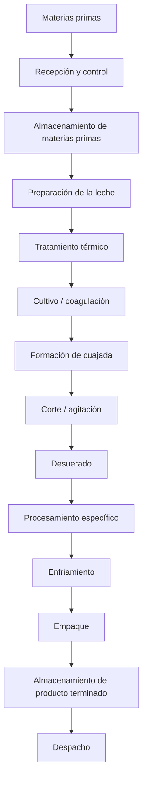
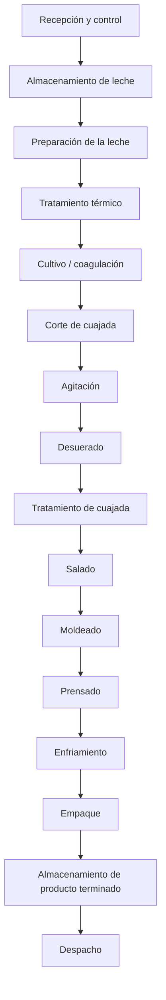
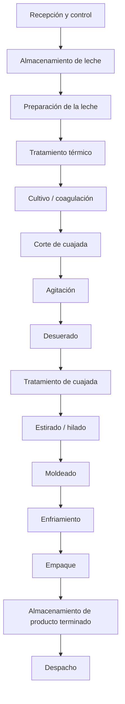
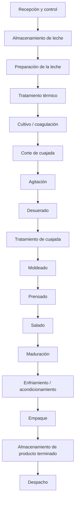
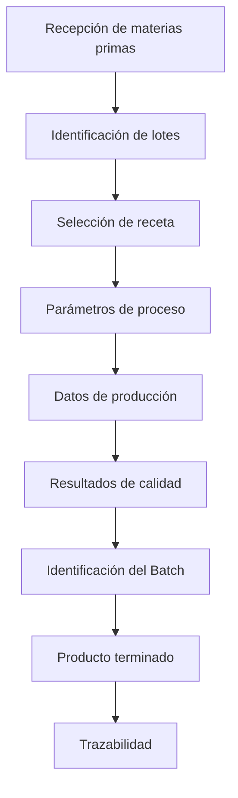
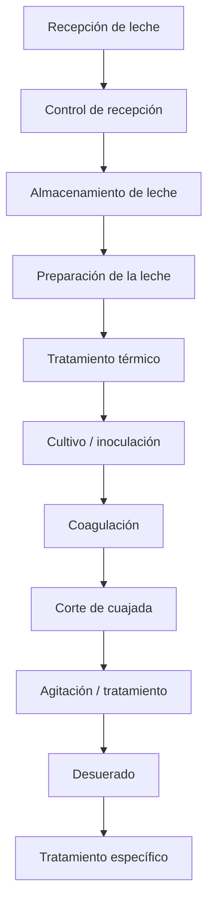
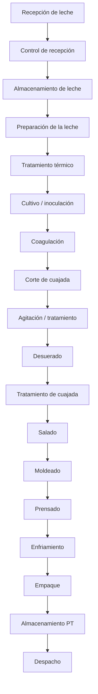
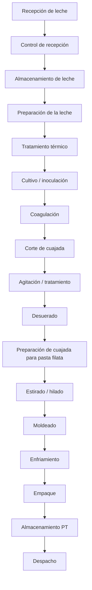
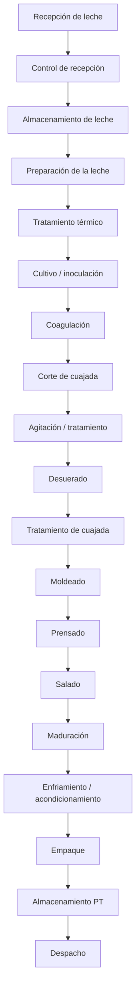

# Línea de Quesos — Modelo TDI

## Información general

**Proyecto:** Transformación Digital Industrial (TDI)
**Empresa de referencia:** Alpina Productos Alimenticios S.A.S.
**Planta de referencia:** Sopó, Cundinamarca, Colombia
**Línea:** Quesos
**Código de línea:** `Q`

> **Nota:** La planta de Sopó se utiliza como referencia del modelo académico. La información interna de Alpina que no sea públicamente verificable no se presenta como dato real de la empresa. En esos casos se utilizarán las etiquetas `REFERENCE`, `ASSUMED`, `CALCULATED` o `PROPOSED`.

---

# Estructura de modelamiento

La línea de quesos se desarrollará utilizando las 12 capas definidas en el estándar general del proyecto:

| Capa | Descripción            | Estado           |
| ---- | ---------------------- | ---------------- |
| 1    | Contexto               | 🟢 En desarrollo |
| 2    | Materias primas        | 🟢 En desarrollo |
| 3    | Flujo general          | ⚪ Pendiente      |
| 4    | Proceso detallado      | ⚪ Pendiente      |
| 5    | Equipos                | ⚪ Pendiente      |
| 6    | Variables              | ⚪ Pendiente      |
| 7    | Sensores y actuadores  | ⚪ Pendiente      |
| 8    | Tiempos                | ⚪ Pendiente      |
| 9    | Capacidades            | ⚪ Pendiente      |
| 10   | Recursos               | ⚪ Pendiente      |
| 11   | Recetas                | ⚪ Pendiente      |
| 12   | Batches y trazabilidad | ⚪ Pendiente      |

---

# Convenciones

## Origen de los datos

Todos los datos deben identificarse mediante una de las siguientes etiquetas:

| Etiqueta     | Significado                                              |
| ------------ | -------------------------------------------------------- |
| `PUBLIC`     | Información pública verificable de la empresa            |
| `REFERENCE`  | Información proveniente de literatura o fuentes técnicas |
| `ASSUMED`    | Supuesto establecido para el modelo académico            |
| `CALCULATED` | Resultado obtenido mediante cálculo                      |
| `PROPOSED`   | Elemento propuesto por el proyecto                       |

### Regla

> Ningún dato numérico debe aparecer sin indicar unidad + origen/estado.

Ejemplo:

```text
Temperatura de pasteurización: 72 °C — REFERENCE
Capacidad del lote: 500 kg/lote — ASSUMED
Producción diaria: 3.000 kg/día — CALCULATED
```

---

## Sistema de identificación

Todos los elementos de la línea de quesos utilizan el prefijo `Q`.

| Elemento          | Código      |
| ----------------- | ----------- |
| Producto          | `Q-PRD-XXX` |
| Operación         | `Q-OP-XXX`  |
| Equipo            | `Q-EQ-XXX`  |
| Variable          | `Q-VAR-XXX` |
| Sensor            | `Q-SEN-XXX` |
| Actuador          | `Q-ACT-XXX` |
| Receta            | `Q-REC-XXX` |
| Recurso           | `Q-RES-XXX` |
| Materia prima     | `Q-MP-XXX`  |
| Material auxiliar | `Q-MA-XXX`  |

Los elementos compartidos de planta utilizarán el prefijo `PL`.

```text
PL-EQ-XXX  → Equipo compartido
PL-RES-XXX → Recurso compartido
```

Los identificadores son únicos y no deben reutilizarse.

---

# Capa 1 — Contexto

## Empresa

**Alpina Productos Alimenticios S.A.S.**

## Planta de referencia

**Sopó, Cundinamarca, Colombia**

La planta de Sopó se utiliza como referencia para construir el modelo académico de la línea de quesos.

La utilización de esta planta como referencia **no implica que los parámetros internos definidos posteriormente correspondan exactamente a la operación real actual de Alpina**.

## Línea de producción

**Línea:** Producción de quesos
**Código:** `Q`

La línea comprende conceptualmente:

```text
Recepción de materias primas
        ↓
Transformación
        ↓
Producto terminado
        ↓
Almacenamiento
        ↓
Despacho
```

## Productos seleccionados

Se seleccionan tres referencias para representar diferentes características y rutas de procesamiento dentro de la línea:

| ID          | Producto         | Categoría    | Presentación de referencia | Origen/Estado |
| ----------- | ---------------- | ------------ | -------------------------- | ------------- |
| `Q-PRD-001` | Queso Campesino  | Queso fresco | Cuña 250 g                 | `PUBLIC`      |
| `Q-PRD-002` | Queso Mozzarella | Queso fresco | Bloque 250 g               | `PUBLIC`      |
| `Q-PRD-003` | Queso Sopó       | Queso maduro | Cuña 180 g                 | `PUBLIC`      |

### Justificación de selección

La selección busca representar productos con diferencias en:

* procesamiento;
* operaciones;
* parámetros;
* tiempos;
* equipos;
* recetas;
* almacenamiento;
* trazabilidad;
* necesidades de producción.

Conceptualmente:

```text
Queso Campesino
    ↓
Producto fresco
    ↓
Proceso relativamente corto
    ↓
Refrigeración


Queso Mozzarella
    ↓
Producto fresco
    ↓
Procesamiento diferenciado de la cuajada
    ↓
Refrigeración


Queso Sopó
    ↓
Producto maduro
    ↓
Proceso + maduración
    ↓
Almacenamiento/maduración
    ↓
Producto terminado
```

> Estas diferencias representan la lógica de modelamiento del proyecto. La secuencia exacta de fabricación de cada referencia deberá validarse mediante fuentes técnicas y, cuando no exista información pública suficiente, mediante supuestos explícitos.

## Alcance del modelo

### Dentro del alcance

El modelo comprende:

* Materias primas
* Operaciones de transformación
* Equipos
* Variables de proceso
* Sensores
* Actuadores
* Tiempos
* Capacidades
* Recursos
* Recetas
* Batches
* Trazabilidad
* Almacenamiento asociado
* Interacción con recursos compartidos de planta

El límite general del modelo es:

```text
Recepción de materias primas
        ↓
Proceso productivo
        ↓
Producto terminado
        ↓
Almacenamiento
        ↓
Despacho
```

### Fuera del alcance inmediato

No se modelará inicialmente:

* Transporte externo
* Distribución nacional
* Puntos de venta
* Comportamiento del consumidor
* Comercialización
* Cadena logística externa

Estos elementos podrán aparecer posteriormente como contexto del proyecto, pero no forman parte del modelo detallado de la línea.

---

# Capa 2 — Materias primas

## Materias primas principales

La materia prima principal de las tres referencias es la leche.

El proceso de elaboración de queso utiliza, dependiendo del producto, cultivos lácticos, agentes coagulantes y sal, además de posibles auxiliares de proceso.

| ID         | Materia prima / insumo | Unidad | Función                                         | Campesino | Mozzarella | Sopó      | Origen/Estado |
| ---------- | ---------------------- | ------ | ----------------------------------------------- | --------- | ---------- | --------- | ------------- |
| `Q-MP-001` | Leche de vaca          | L      | Materia prima principal                         | ✓         | ✓          | ✓         | `REFERENCE`   |
| `Q-MP-002` | Cultivos lácticos      | kg / L | Fermentación y desarrollo de características    | ✓         | ✓          | ✓         | `REFERENCE`   |
| `Q-MP-003` | Cuajo / coagulante     | kg / L | Coagulación de la leche                         | ✓         | ✓          | ✓         | `REFERENCE`   |
| `Q-MP-004` | Sal / NaCl             | kg     | Salado, sabor y conservación                    | ✓         | ✓          | ✓         | `REFERENCE`   |
| `Q-MP-005` | Cloruro de calcio      | kg / L | Auxiliar de coagulación y firmeza de la cuajada | Pendiente | Pendiente  | Pendiente | `REFERENCE`   |

> El cloruro de calcio se mantiene como posible insumo técnico, pero su utilización específica en cada referencia debe validarse antes de incorporarlo a las recetas.

## `Q-MP-001` — Leche de vaca

La leche constituye la materia prima base de las tres referencias.

**Unidad de modelamiento:** `L`

Características relevantes que posteriormente podrán convertirse en variables de proceso o de calidad:

* Temperatura de recepción
* Acidez
* pH
* Grasa
* Proteína
* Sólidos totales
* Carga microbiológica
* Volumen recibido

Las cantidades por batch todavía no se han definido.

## `Q-MP-002` — Cultivos lácticos

Los cultivos lácticos participan en la acidificación y en el desarrollo de características del queso.

**Unidad provisional:** `kg` o `L`

La cantidad exacta dependerá de:

* Producto
* Tipo de cultivo
* Concentración
* Tamaño del batch
* Condiciones de proceso
* Receta

Por lo tanto, la cantidad se definirá posteriormente en la capa de recetas.

## `Q-MP-003` — Cuajo / coagulante

El cuajo o coagulante produce la coagulación de la leche y permite formar la cuajada.

**Unidad provisional:** `kg` o `L`

La cantidad dependerá de:

* Potencia del coagulante
* Volumen de leche
* Temperatura
* Tiempo de coagulación
* Especificación de la receta

No se establece todavía un valor numérico.

## `Q-MP-004` — Sal / NaCl

La sal participa en:

* Desarrollo del sabor
* Conservación
* Control microbiológico
* Regulación de humedad
* Características finales del queso

**Unidad:** `kg`

La etapa exacta de incorporación dependerá del producto y será definida en el proceso detallado y en las recetas.

## `Q-MP-005` — Cloruro de calcio

El cloruro de calcio se mantiene como un posible auxiliar de proceso para mejorar la formación y firmeza de la cuajada.

**Unidad:** `kg` o `L`

**Origen:** `REFERENCE`

**Estado:** Pendiente de validación por producto.

No se afirmará que Alpina utiliza este insumo en una referencia específica sin evidencia suficiente.

---

# Materiales auxiliares y de empaque

Para efectos del modelo TDI, los materiales de empaque se registrarán separadamente de las materias primas.

| ID         | Material                     | Unidad | Función                       | Origen/Estado |
| ---------- | ---------------------------- | ------ | ----------------------------- | ------------- |
| `Q-MA-001` | Material de empaque primario | unidad | Contener el producto          | `PROPOSED`    |
| `Q-MA-002` | Etiqueta                     | unidad | Identificación y trazabilidad | `PROPOSED`    |
| `Q-MA-003` | Embalaje secundario          | unidad | Agrupación y transporte       | `PROPOSED`    |

Las especificaciones concretas de los materiales de empaque se definirán posteriormente.

---

# Relación Producto → Receta → Batch

La estructura fundamental del modelo será:

```text
PRODUCTO
   ↓
RECETA
   ↓
BATCH
```

## Producto

Representa **qué se fabrica**.

Ejemplo:

```text
Q-PRD-001
Queso Campesino 250 g
```

## Receta

Representa **cómo se fabrica**.

Una receta podrá contener:

* Materias primas
* Cantidades
* Secuencia de operaciones
* Temperaturas
* Tiempos
* Velocidades
* Parámetros de proceso
* Condiciones de operación
* Criterios de calidad

Ejemplo:

```text
Q-REC-001
Receta de Queso Campesino
```

## Batch

Representa una **ejecución concreta del proceso de producción**.

Ejemplo:

```text
Batch ID:
20261005-Q-001-001
```

Información asociada:

```text
Producto: Q-PRD-001
Receta: Q-REC-001
Cantidad: pendiente
Fecha: 05/10/2026
```

Posteriormente, el batch deberá permitir registrar:

* Producto fabricado
* Versión de receta
* Materias primas utilizadas
* Equipos utilizados
* Parámetros reales del proceso
* Condiciones de producción
* Resultados de calidad
* Producto terminado

Esto permitirá construir la trazabilidad digital de la producción.

---

# Datos pendientes de definición

Los siguientes valores **no deben definirse arbitrariamente**. Se establecerán en las siguientes capas mediante referencias, supuestos y cálculos:

* Tamaño de batch
* Cantidad de leche por batch
* Cantidad de cultivos
* Cantidad de cuajo
* Cantidad de sal
* Uso de cloruro de calcio
* Rendimiento de producción
* Pérdidas
* Tiempos de operación
* Temperaturas
* Capacidades
* Equipos específicos
* Recursos requeridos

La secuencia de trabajo será:

```text
Materias primas
      ↓
Recetas
      ↓
Balance de masa
      ↓
Batch
      ↓
Tiempos
      ↓
Capacidades
```

---

# Fuentes iniciales

Las fuentes deben ampliarse a medida que se desarrollen las siguientes capas.

### Alpina — Portafolio de quesos

* https://alpina.com/quesos

### Alpina — Queso Campesino

* https://alpina.com/queso-campesino-alpina-cu-a-250-g

### Alpina — Queso Mozzarella

* https://alpina.com/queso-mozarella-alpina-bloque-250-g

### Alpina — Queso Sopó

* https://alpina.com/quesos/quesos-maduros/queso-sopo

### Referencias técnicas

Las fuentes técnicas sobre elaboración de queso se utilizarán para establecer procesos, materias primas y parámetros cuando la información específica de Alpina no esté disponible públicamente.

---
# Capa 3 — Flujo general

La línea de quesos se modela como un **flujo común con rutas diferenciadas según el producto**. La secuencia general permite identificar las principales etapas de transformación, almacenamiento y despacho. Los parámetros específicos de cada operación se desarrollarán posteriormente en la Capa 4.

## Flujo general de la línea



## Ruta — Queso Campesino



## Ruta — Queso Mozzarella



## Ruta — Queso Sopó



## Entradas

Las principales entradas identificadas para la línea son:

| Tipo                   | Elementos                                                                           |
| ---------------------- | ----------------------------------------------------------------------------------- |
| Materias primas        | Leche, cultivos lácticos, cuajo/coagulante, sal y otros auxiliares                  |
| Materiales de empaque  | Empaque primario, etiquetas y empaque secundario                                    |
| Servicios industriales | Agua, energía eléctrica, refrigeración, vapor y aire comprimido, según la operación |

## Salidas

El proceso genera principalmente:

* **Producto terminado:** queso correspondiente a cada referencia.
* **Suero lácteo:** subproducto generado durante la separación de la cuajada.
* **Residuos y desperdicios:** materiales o producto descartado durante el proceso.
* **Información de producción:** datos asociados a materias primas, parámetros, equipos, calidad y trazabilidad.

El suero será considerado posteriormente en el **balance de masa**, el análisis de aprovechamiento de subproductos y la evaluación de recursos de la planta.

## Flujo de información

El flujo físico se complementa con un flujo de información asociado a cada producción:



Esta estructura permitirá posteriormente relacionar el proceso físico con **sensores, actuadores y sistemas digitales** como SCADA, MES y ERP.

## Puntos de almacenamiento identificados

| Punto                                   | Función                                        | Estado   |
| --------------------------------------- | ---------------------------------------------- | -------- |
| Almacenamiento de leche                 | Conservación de materia prima                  | PROPOSED |
| Almacenamiento de materiales de empaque | Disponibilidad de materiales                   | PROPOSED |
| Almacenamiento intermedio               | Conservación temporal de productos/intermedios | PROPOSED |
| Cámara de maduración                    | Maduración del Queso Sopó                      | PROPOSED |
| Almacenamiento de producto terminado    | Conservación antes del despacho                | PROPOSED |

Las capacidades, tiempos de permanencia e inventarios asociados se definirán posteriormente.

## Consideraciones del flujo

* La línea presenta una **secuencia base común**, con operaciones específicas dependiendo de la referencia.
* El **Queso Campesino** incorpora salado, moldeado y prensado.
* El **Queso Mozzarella** incorpora la operación de estirado o hilado.
* El **Queso Sopó** incorpora una etapa de maduración.
* El flujo físico y el flujo de información deben mantenerse asociados mediante la identificación de **lotes, recetas y batches**.
* Las rutas representan el **modelo académico propuesto para la línea** y no necesariamente la secuencia interna exacta de producción de Alpina.
* Los parámetros de operación, tiempos, equipos, capacidades y condiciones específicas se definirán en las capas siguientes.

## Relación con las siguientes capas

El flujo definido en esta capa será la base para desarrollar:

**Flujo → Operaciones → Equipos → Variables → Sensores/actuadores → Tiempos → Capacidades → Recursos → Recetas → Batches y trazabilidad**

Por tanto, cada operación identificada en los diagramas deberá poder relacionarse posteriormente con un identificador `Q-OP-XXX` y con los elementos correspondientes del modelo.

## Estado de la capa

| Elemento                 | Estado                           |
| ------------------------ | -------------------------------- |
| Flujo general            | 🟢 Definido                      |
| Rutas por producto       | 🟢 Definidas                     |
| Entradas                 | 🟢 Identificadas                 |
| Salidas                  | 🟢 Identificadas                 |
| Flujo de información     | 🟢 Definido conceptualmente      |
| Puntos de almacenamiento | 🟡 Identificados preliminarmente |
| Parámetros de proceso    | ⚪ Pendiente — Capa 4             |
| Equipos asociados        | ⚪ Pendiente — Capa 5             |
| Variables                | ⚪ Pendiente — Capa 6             |
| Sensores y actuadores    | ⚪ Pendiente — Capa 7             |
| Tiempos                  | ⚪ Pendiente — Capa 8             |
| Capacidades              | ⚪ Pendiente — Capa 9             |
 
# Capa 4 — Proceso detallado

Esta capa descompone el flujo general de la línea en **operaciones de proceso identificables**, estableciendo sus entradas, salidas y productos asociados.

El modelo se construye a partir de referencias técnicas sobre fabricación de queso y de la clasificación pública de los productos de Alpina. Los parámetros específicos de operación de Alpina no se asumen como información pública; cuando no existe información verificable, el dato se marcará como `ASSUMED` o `PROPOSED`.

La secuencia general de elaboración de queso incluye operaciones como preparación de la leche, tratamiento térmico, acidificación/cultivo, coagulación, corte de la cuajada, separación del suero y tratamiento posterior de la cuajada. La forma específica en que estas operaciones se combinan depende del tipo de queso.

## Process Master

| ID       | Operación                            | Entrada principal            | Salida principal              | Producto         | Origen/Estado |
| -------- | ------------------------------------ | ---------------------------- | ----------------------------- | ---------------- | ------------- |
| Q-OP-001 | Recepción de leche                   | Leche                        | Leche recibida                | Todos            | REFERENCE     |
| Q-OP-002 | Control de recepción                 | Leche recibida               | Leche aprobada/rechazada      | Todos            | REFERENCE     |
| Q-OP-003 | Almacenamiento de leche              | Leche aprobada               | Leche disponible              | Todos            | PROPOSED      |
| Q-OP-004 | Preparación de la leche              | Leche                        | Leche preparada               | Todos            | REFERENCE     |
| Q-OP-005 | Tratamiento térmico                  | Leche preparada              | Leche tratada                 | Todos            | REFERENCE     |
| Q-OP-006 | Cultivo / inoculación                | Leche tratada                | Leche inoculada               | Todos            | REFERENCE     |
| Q-OP-007 | Coagulación                          | Leche inoculada + coagulante | Cuajada                       | Todos            | REFERENCE     |
| Q-OP-008 | Corte de cuajada                     | Cuajada                      | Cuajada cortada + suero       | Todos            | REFERENCE     |
| Q-OP-009 | Agitación / tratamiento de cuajada   | Cuajada cortada              | Cuajada acondicionada + suero | Todos            | REFERENCE     |
| Q-OP-010 | Desuerado                            | Cuajada + suero              | Cuajada + suero separado      | Todos            | REFERENCE     |
| Q-OP-011 | Tratamiento específico de cuajada    | Cuajada                      | Cuajada procesada             | Según producto   | REFERENCE     |
| Q-OP-012 | Salado                               | Cuajada / queso              | Producto salado               | Campesino / Sopó | REFERENCE     |
| Q-OP-013 | Moldeado                             | Cuajada / queso              | Queso moldeado                | Según producto   | REFERENCE     |
| Q-OP-014 | Prensado                             | Queso moldeado               | Queso prensado                | Campesino / Sopó | REFERENCE     |
| Q-OP-015 | Estirado / hilado                    | Cuajada                      | Queso de pasta filata         | Mozzarella       | REFERENCE     |
| Q-OP-016 | Maduración                           | Queso                        | Queso madurado                | Sopó             | REFERENCE     |
| Q-OP-017 | Enfriamiento / acondicionamiento     | Queso procesado              | Queso acondicionado           | Todos            | PROPOSED      |
| Q-OP-018 | Empaque                              | Queso acondicionado          | Producto empacado             | Todos            | PROPOSED      |
| Q-OP-019 | Almacenamiento de producto terminado | Producto empacado            | Producto disponible           | Todos            | PROPOSED      |
| Q-OP-020 | Despacho                             | Producto terminado           | Producto despachado           | Todos            | PROPOSED      |

La secuencia de operaciones se basa en el proceso general de elaboración de queso descrito en literatura técnica; las operaciones específicas de Mozzarella y maduración se diferencian de acuerdo con las características de cada referencia.

## Proceso común

Las operaciones iniciales de la línea se pueden representar como:



La coagulación transforma la leche en una estructura de cuajada y, posteriormente, el corte facilita la separación del suero. El cultivo y las condiciones de procesamiento influyen sobre la humedad, textura, sabor y características finales del queso.

## Ruta de proceso — Queso Campesino

El Queso Campesino de Alpina está clasificado públicamente como un queso fresco.

Para el modelo académico se establece la siguiente ruta:



**Características de modelamiento:**

* Producto fresco.
* No se incorpora una etapa prolongada de maduración en el modelo.
* El salado, moldeado y prensado se consideran operaciones diferenciadoras de la ruta.
* Los tiempos, temperaturas, presiones y cantidades serán definidos posteriormente.

## Ruta de proceso — Queso Mozzarella

Alpina comercializa actualmente la Mozzarella en diferentes presentaciones y la clasifica como una categoría de queso fresco.

La Mozzarella pertenece al grupo de quesos de tipo *pasta filata*, cuyo proceso incluye una etapa de calentamiento y estirado de la cuajada para desarrollar su estructura característica.

Para el modelo académico:



**Características de modelamiento:**

* La etapa de estirado/hilado es una operación diferenciadora.
* Esta etapa implica tratamiento termo-mecánico de la cuajada.
* La temperatura, humedad, pH, velocidad y condiciones de estirado serán variables relevantes para las capas posteriores.
* No se incorpora una etapa prolongada de maduración en la ruta inicial.

## Ruta de proceso — Queso Sopó

Alpina identifica el Queso Sopó como un queso maduro y describe características que dependen de su punto de maduración.

Para el modelo académico:



**Características de modelamiento:**

* Incluye una etapa de maduración.
* La maduración constituye una etapa diferenciadora respecto a los productos frescos.
* Durante esta etapa serán relevantes variables como temperatura, humedad, tiempo y condiciones ambientales.
* La duración y condiciones exactas de maduración serán definidas posteriormente y no se asumirán como datos internos de Alpina.

## Operaciones y elementos que deberán definirse posteriormente

Cada operación del `Process Master` servirá como referencia para las siguientes capas:

| Capa         | Información derivada del proceso                         |
| ------------ | -------------------------------------------------------- |
| Equipos      | Equipo utilizado en cada operación                       |
| Variables    | Variables físicas y químicas relevantes                  |
| Sensores     | Instrumentación necesaria                                |
| Actuadores   | Elementos utilizados para modificar/controlar el proceso |
| Tiempos      | Duración y tiempo de ciclo                               |
| Capacidades  | Capacidad de equipo, lote y producción                   |
| Recursos     | Personal, materiales y servicios                         |
| Recetas      | Parámetros específicos de cada referencia                |
| Batches      | Ejecución concreta de una receta                         |
| Trazabilidad | Registro de materiales, parámetros y resultados          |

## Estado de la información

| Tipo de información              | Estado                      |
| -------------------------------- | --------------------------- |
| Secuencia general de operaciones | 🟢 Definida                 |
| Operaciones comunes              | 🟢 Definidas                |
| Diferenciación Campesino         | 🟢 Definida preliminarmente |
| Diferenciación Mozzarella        | 🟢 Definida                 |
| Diferenciación Sopó              | 🟢 Definida                 |
| Parámetros de proceso            | ⚪ Pendiente                 |
| Equipos                          | ⚪ Capa 5                    |
| Variables                        | ⚪ Capa 6                    |
| Sensores y actuadores            | ⚪ Capa 7                    |
| Tiempos                          | ⚪ Capa 8                    |
| Capacidades                      | ⚪ Capa 9                    |

> **Nota metodológica:** Las secuencias anteriores representan el modelo académico de la línea de quesos. Las fuentes técnicas permiten establecer operaciones características de la elaboración de queso, pero no permiten inferir automáticamente los procedimientos internos específicos de Alpina. Por ello, los parámetros industriales específicos deberán clasificarse como `PUBLIC`, `REFERENCE`, `ASSUMED`, `CALCULATED` o `PROPOSED` según corresponda.


# Capa 5 — Equipos

## 1. Objetivo

Identificar los equipos industriales asociados a las operaciones de la línea de quesos, describiendo su función, las operaciones que soportan y las características técnicas relevantes para el modelamiento de la planta.

Este modelo utiliza como referencia la clasificación de productos definida en la Capa 1 y los flujos de proceso establecidos en las Capas 3 y 4.

**Alcance:** los equipos presentados corresponden a una propuesta de modelamiento académico. No constituyen un inventario verificado de los equipos instalados en la planta de Alpina en Sopó.

## 2. Inventario preliminar de equipos

| ID | Equipo | Operación asociada | Función principal | Productos | Origen/Estado |
|---|---|---|---|---|---|
| Q-EQ-001 | Tanque de recepción de leche | Q-OP-001 | Recibir temporalmente la leche cruda | Todos | PROPOSED |
| Q-EQ-002 | Sistema de almacenamiento refrigerado de leche | Q-OP-003 | Conservar la leche antes del procesamiento | Todos | PROPOSED |
| Q-EQ-003 | Sistema de preparación de leche | Q-OP-004 | Acondicionar la leche para su procesamiento | Todos | PROPOSED |
| Q-EQ-004 | Pasteurizador o sistema de tratamiento térmico | Q-OP-005 | Aplicar el tratamiento térmico requerido | Todos | REFERENCE |
| Q-EQ-005 | Tanque de elaboración de queso | Q-OP-006, Q-OP-007 | Permitir la inoculación y la coagulación | Todos | REFERENCE |
| Q-EQ-006 | Sistema de corte de cuajada | Q-OP-008 | Dividir la cuajada para facilitar la separación del suero | Todos | REFERENCE |
| Q-EQ-007 | Tina o tanque de tratamiento de cuajada | Q-OP-009 | Permitir agitación y acondicionamiento de la cuajada | Todos | REFERENCE |
| Q-EQ-008 | Sistema de desuerado | Q-OP-010 | Separar la cuajada del suero | Todos | REFERENCE |
| Q-EQ-009 | Sistema de tratamiento específico de cuajada | Q-OP-011 | Ejecutar el acondicionamiento particular requerido por cada queso | Todos | REFERENCE |
| Q-EQ-010 | Sistema de salado | Q-OP-012 | Incorporar sal al producto cuando corresponda | Campesino y Sopó | REFERENCE |
| Q-EQ-011 | Sistema de moldeado | Q-OP-013 | Dar forma al queso | Todos | REFERENCE |
| Q-EQ-012 | Prensa para queso | Q-OP-014 | Aplicar presión para obtener las características requeridas | Campesino y Sopó | REFERENCE |
| Q-EQ-013 | Sistema de estirado o hilado | Q-OP-015 | Estirar la cuajada característica de la mozzarella | Mozzarella | REFERENCE |
| Q-EQ-014 | Cámara o sistema de maduración | Q-OP-016 | Mantener condiciones controladas durante la maduración | Sopó | PROPOSED |
| Q-EQ-015 | Sistema de enfriamiento o acondicionamiento | Q-OP-017 | Llevar el producto a las condiciones requeridas para las etapas posteriores | Todos | PROPOSED |
| Q-EQ-016 | Máquina o sistema de empaque | Q-OP-018 | Empacar y proteger el producto terminado | Todos | PROPOSED |
| Q-EQ-017 | Sistema de almacenamiento de producto terminado | Q-OP-019 | Conservar el producto empacado antes del despacho | Todos | PROPOSED |
| Q-EQ-018 | Sistema de despacho y manipulación | Q-OP-020 | Facilitar la preparación y salida del producto terminado | Todos | PROPOSED |

**Interpretación de los estados:**

- **REFERENCE:** equipo o función técnicamente reconocible en procesos de elaboración de queso; no implica que se haya verificado su instalación en Alpina.
- **PROPOSED:** equipo o sistema incluido provisionalmente en el modelo, pendiente de validación.
- **PUBLIC:** se utilizará cuando exista evidencia pública verificable sobre un equipo específico de la planta.
- **ASSUMED:** se utilizará para una característica adoptada explícitamente como supuesto del modelo.
- **CALCULATED:** se utilizará para un valor obtenido mediante cálculo.

## 3. Características técnicas que debemos registrar

Para cada equipo se recopilarán progresivamente las siguientes características, cuando sean pertinentes:

| Característica | Unidad estándar | Utilidad |
|---|---|---|
| Capacidad de procesamiento | L/h o kg/h | Estimar el flujo de producción |
| Capacidad por lote | L/lote o kg/lote | Relacionar el equipo con el tamaño del batch |
| Tiempo de operación | min o h | Estimar duración y utilización |
| Temperatura de operación | °C | Modelar las condiciones térmicas |
| Presión de operación | bar | Caracterizar equipos que trabajen a presión |
| Potencia instalada | kW | Estimar requerimientos eléctricos |
| Consumo energético | kWh | Evaluar el consumo por operación |
| Dimensiones o volumen útil | m³ o L | Evaluar almacenamiento y capacidad física |
| Requerimientos de servicios | Según servicio | Identificar agua, vapor, refrigeración, aire o electricidad |

No todas las características aplican a todos los equipos. Por ejemplo, la presión será relevante para determinados sistemas, mientras que el volumen útil será especialmente importante para tanques y cámaras.

## 4. Relación entre equipos y operaciones

Un equipo puede intervenir en más de una operación y una operación puede requerir varios equipos. Por tanto, la relación no debe interpretarse como una correspondencia obligatoria de uno a uno.

Ejemplos:

- El tanque de elaboración puede utilizarse para la inoculación, la coagulación y algunas etapas de tratamiento de la cuajada, dependiendo de su configuración.
- El tratamiento térmico puede implementarse mediante un sistema por lotes o uno continuo.
- El almacenamiento refrigerado puede depender de un sistema central de refrigeración compartido con otras líneas.
- El empaque puede integrar alimentación, dosificación, sellado, etiquetado y verificación, según la presentación del producto.

La configuración exacta se mantiene pendiente de validación.

## 5. Integración con las demás capas

La Capa 5 se conecta directamente con el resto del modelo:

- **Capa 4 — Proceso detallado:** identifica las operaciones que requieren equipos.
- **Capa 6 — Variables:** determina qué magnitudes deben medirse o controlarse en cada equipo.
- **Capa 7 — Sensores y actuadores:** identifica los elementos utilizados para medir y actuar.
- **Capa 8 — Tiempos:** caracteriza la duración de las operaciones.
- **Capa 9 — Capacidades:** permite estimar la producción posible.
- **Capa 10 — Recursos:** incorpora personal, servicios y otros recursos necesarios.
- **Capa 11 — Recetas:** relaciona las condiciones de operación con cada producto.
- **Capa 12 — Batches y trazabilidad:** permite asociar los equipos utilizados con cada ejecución de producción.

## 6. Información pendiente

Antes de atribuir capacidades o especificaciones numéricas a los equipos, debemos identificar qué información está disponible y cuál requiere estimación.

| Información | Estado |
|---|---|
| Inventario real de equipos de Alpina Sopó | Pendiente de verificar |
| Fabricante y modelo de cada equipo | Pendiente |
| Capacidades nominales y útiles | Pendiente |
| Tiempos de operación y limpieza | Pendiente |
| Instrumentación instalada | Se desarrollará en las Capas 6 y 7 |
| Consumos energéticos y servicios | Pendiente |
| Equipos compartidos con otras líneas | Pendiente de integración de planta |

## 7. Criterio de cierre de la capa

La capa se considerará suficientemente desarrollada cuando cada operación del proceso tenga identificados los equipos requeridos, su función y las características técnicas relevantes, distinguiendo claramente la información verificada de las referencias técnicas y los supuestos.

**Estado actual:** inventario conceptual preliminar definido. Las capacidades, especificaciones y correspondencia con los equipos reales de la planta quedan pendientes de validación.

 # Capa 6 — Variables

## 1. Objetivo

Identificar las variables de proceso relevantes para la elaboración de los quesos Campesino, Mozzarella y Sopó, estableciendo su relación con las operaciones productivas y los equipos definidos en las capas anteriores.

La identificación de estas variables constituye la base para determinar los requerimientos de instrumentación, supervisión y control de la línea de producción.

Las variables se clasifican según su naturaleza y función dentro del proceso. Su inclusión en el modelo no implica que todas se midan actualmente en la planta de referencia ni que todas requieran control automático.

## 2. Inventario de variables de proceso

| ID | Variable | Unidad | Operación asociada | Aplicación | Origen/Estado |
|---|---|---|---|---|---|
| Q-VAR-001 | Temperatura de la leche | °C | Q-OP-004, Q-OP-005 | Preparación y tratamiento térmico | REFERENCE |
| Q-VAR-002 | Tiempo de tratamiento térmico | min | Q-OP-005 | Verificación de las condiciones del tratamiento | REFERENCE |
| Q-VAR-003 | Temperatura de inoculación | °C | Q-OP-006 | Condiciones para la incorporación y actividad de los cultivos | REFERENCE |
| Q-VAR-004 | pH de la leche o mezcla | Sin unidad | Q-OP-006, Q-OP-007 | Seguimiento de la acidificación y condiciones de coagulación | REFERENCE |
| Q-VAR-005 | Tiempo de coagulación | min | Q-OP-007 | Seguimiento de la formación de cuajada | REFERENCE |
| Q-VAR-006 | Temperatura de coagulación | °C | Q-OP-007 | Control de las condiciones de formación de cuajada | REFERENCE |
| Q-VAR-007 | Tamaño de corte de la cuajada | mm | Q-OP-008 | Caracterización del corte y de las condiciones de desuerado | REFERENCE |
| Q-VAR-008 | Velocidad de agitación | rpm | Q-OP-009 | Control de la intensidad de agitación | REFERENCE |
| Q-VAR-009 | Tiempo de agitación | min | Q-OP-009 | Caracterización del tratamiento de la cuajada | REFERENCE |
| Q-VAR-010 | Temperatura de tratamiento de cuajada | °C | Q-OP-009, Q-OP-011 | Acondicionamiento de la cuajada | REFERENCE |
| Q-VAR-011 | Masa de cuajada procesada | kg | Q-OP-009, Q-OP-010, Q-OP-011 | Seguimiento del material en proceso | PROPOSED |
| Q-VAR-012 | Volumen o masa de suero separado | L o kg | Q-OP-010 | Balance de materiales y seguimiento del desuerado | PROPOSED |
| Q-VAR-013 | Cantidad de sal incorporada | kg | Q-OP-012 | Dosificación de sal según la receta | REFERENCE |
| Q-VAR-014 | Presión de prensado | bar | Q-OP-014 | Caracterización del prensado, cuando aplique | REFERENCE |
| Q-VAR-015 | Tiempo de prensado | min | Q-OP-014 | Determinación de la duración de la operación | REFERENCE |
| Q-VAR-016 | Temperatura de estirado o hilado | °C | Q-OP-015 | Acondicionamiento de la cuajada para mozzarella | REFERENCE |
| Q-VAR-017 | Temperatura de maduración | °C | Q-OP-016 | Seguimiento de las condiciones de maduración del queso Sopó | REFERENCE |
| Q-VAR-018 | Humedad relativa de maduración | % RH | Q-OP-016 | Seguimiento ambiental durante la maduración | REFERENCE |
| Q-VAR-019 | Tiempo de maduración | h o días | Q-OP-016 | Determinación de la duración de la maduración | REFERENCE |
| Q-VAR-020 | Temperatura del producto antes del empaque | °C | Q-OP-017 | Verificación de las condiciones previas al empaque | PROPOSED |
| Q-VAR-021 | Masa de producto terminado | kg | Q-OP-018, Q-OP-019 | Registro de producción y cálculo del rendimiento | PROPOSED |
| Q-VAR-022 | Tiempo de operación | min | Todas las operaciones | Análisis de tiempos y utilización de equipos | PROPOSED |

**Nota sobre las unidades:** la variable debe registrarse en una unidad coherente con el instrumento, el procedimiento de medición y el modelo de datos. Para el pH no se utiliza una unidad física; para el tiempo de maduración se admiten horas o días, manteniendo la unidad explícita en cada registro.

## 3. Variables específicas por producto

Aunque las tres referencias comparten operaciones, algunas variables adquieren mayor relevancia según las características del queso.

| Producto | Variables de especial interés | Justificación |
|---|---|---|
| Queso Campesino | Temperatura de tratamiento, pH, tiempo de coagulación, condiciones de desuerado, salado y prensado cuando aplique | Caracterización de la elaboración y consistencia del producto fresco |
| Queso Mozzarella | pH, temperatura y condiciones del estirado, tiempo de procesamiento y enfriamiento | Caracterización de la etapa de pasta filata y de la formación de la estructura del queso |
| Queso Sopó | pH, condiciones de prensado y salado, temperatura, humedad relativa y tiempo de maduración | Seguimiento del proceso de elaboración y maduración |

La selección definitiva de variables y sus rangos de operación dependerá de la receta y de la información técnica disponible para cada referencia. No se establecen valores objetivo en esta capa.

## 4. Clasificación según su función

Para facilitar la instrumentación y el diseño posterior de la arquitectura digital, las variables se agrupan en cuatro categorías:

| Categoría | Variables representativas | Aplicación |
|---|---|---|
| Variables térmicas | Temperatura de leche, cuajada, estirado y maduración | Supervisión y regulación de condiciones térmicas |
| Variables fisicoquímicas | pH | Seguimiento de condiciones de acidificación y procesamiento |
| Variables mecánicas y operativas | Velocidad de agitación, presión y tiempos de operación | Caracterización y control de las operaciones |
| Variables de producción y balance | Masa de cuajada, suero separado y producto terminado | Balance de materiales, rendimiento y trazabilidad |

Esta clasificación facilita la identificación de los puntos de medición y de las necesidades de adquisición de datos. No todas las variables requieren un sensor continuo: algunas pueden obtenerse mediante muestreo, inspección, medición manual o registro del operario.

## 5. Relación con equipos e instrumentación

Las variables identificadas se vinculan con los equipos de la Capa 5 para establecer dónde deben observarse y qué requerimientos de instrumentación podrían existir.

| Equipo | Variables asociadas | Instrumentación potencial |
|---|---|---|
| Q-EQ-002 — Almacenamiento refrigerado de leche | Temperatura de la leche | Sensor de temperatura |
| Q-EQ-004 — Sistema de tratamiento térmico | Temperatura y tiempo de tratamiento | Sensor de temperatura y registro temporal |
| Q-EQ-005 — Tanque de elaboración | Temperatura, pH y tiempo de coagulación | Sensor de temperatura, medidor de pH y registro temporal |
| Q-EQ-006 — Sistema de corte | Tamaño de corte | Ajuste mecánico y verificación del procedimiento |
| Q-EQ-007 — Tina de tratamiento de cuajada | Temperatura, velocidad y tiempo de agitación | Sensor de temperatura, medición de velocidad y temporizador |
| Q-EQ-008 — Sistema de desuerado | Masa o volumen de suero separado | Sistema de pesaje o medición de flujo, según configuración |
| Q-EQ-012 — Prensa para queso | Presión y tiempo de prensado | Sensor de presión y temporizador, cuando corresponda |
| Q-EQ-013 — Sistema de estirado o hilado | Temperatura de estirado | Sensor de temperatura |
| Q-EQ-014 — Sistema de maduración | Temperatura, humedad relativa y tiempo | Sensores ambientales y registro temporal |
| Q-EQ-015 — Sistema de enfriamiento | Temperatura del producto | Sensor de temperatura |
| Q-EQ-016 — Sistema de empaque | Masa o presentación empacada y tiempo de operación | Sistema de pesaje o verificación y registro de producción |

La instrumentación indicada es una propuesta funcional. La tecnología, precisión, ubicación y cantidad de instrumentos se definirán a partir de los requerimientos del proceso y de la arquitectura de automatización que se desarrolle posteriormente.

## 6. Registro de información y trazabilidad

Para que las variables puedan incorporarse a un sistema de información industrial, cada registro debería asociarse, cuando corresponda, con:

- Identificador de la variable.
- Fecha y hora de medición.
- Valor y unidad.
- Equipo u operación de origen.
- Identificador del batch.
- Producto y versión de receta.
- Origen del dato: sensor, laboratorio, operario o cálculo.
- Estado del dato: medido, estimado, calculado o pendiente de validación.

Esta estructura permite relacionar las condiciones de fabricación con los resultados de producción y calidad. También constituye una base para analizar variabilidad, detectar desviaciones y evaluar oportunidades de mejora.

## 7. Estado del modelamiento

El inventario define las variables relevantes para el análisis preliminar de las tres referencias de queso. La existencia de una variable en el modelo no implica que esté instrumentada en la planta actual.

Quedan pendientes de validación los rangos de operación, los valores objetivo por producto, los métodos de medición disponibles y la instrumentación instalada. Estos aspectos se precisarán a medida que se incorporen fuentes técnicas y se desarrolle el diseño de control y adquisición de datos.

# Capa 7 — Sensores y actuadores

## 1. Objetivo

Identificar los instrumentos de medición y los elementos de actuación asociados a las operaciones de la línea de quesos Campesino, Mozzarella y Sopó. Esta capa establece la relación entre las variables del proceso, los dispositivos que permiten medirlas y los elementos que permiten modificar las condiciones de operación.

La instrumentación se plantea como una propuesta funcional de modelamiento. No se dispone de un inventario verificado de los sensores, actuadores y sistemas de control instalados en la planta de referencia de Alpina en Sopó.

## 2. Sensores e instrumentos de medición

| ID | Sensor o instrumento | Variable asociada | Unidad de medición | Aplicación | Origen/Estado |
|---|---|---|---|---|---|
| Q-SEN-001 | Sensor de temperatura | Q-VAR-001, Q-VAR-020 | °C | Medición de temperatura de leche y producto | PROPOSED |
| Q-SEN-002 | Sensor de temperatura para tratamiento térmico | Q-VAR-001 | °C | Seguimiento de la temperatura durante el tratamiento | PROPOSED |
| Q-SEN-003 | Registrador o temporizador de proceso | Q-VAR-002, Q-VAR-005, Q-VAR-009, Q-VAR-015, Q-VAR-019, Q-VAR-022 | min, h o días | Registro de duración de operaciones y etapas | PROPOSED |
| Q-SEN-004 | Medidor de pH | Q-VAR-004 | Sin unidad | Medición de pH en leche, mezcla o cuajada, según el procedimiento | PROPOSED |
| Q-SEN-005 | Sistema de medición o verificación del corte | Q-VAR-007 | mm | Verificación del tamaño de corte de la cuajada | PROPOSED |
| Q-SEN-006 | Sensor o indicador de velocidad | Q-VAR-008 | rpm | Medición de la velocidad de agitación | PROPOSED |
| Q-SEN-007 | Sistema de pesaje | Q-VAR-011, Q-VAR-021 | kg | Registro de masa de cuajada y producto terminado | PROPOSED |
| Q-SEN-008 | Medidor de flujo o sistema de pesaje de suero | Q-VAR-012 | L o kg | Cuantificación del suero separado | PROPOSED |
| Q-SEN-009 | Sensor de presión | Q-VAR-014 | bar | Medición de presión durante el prensado, cuando aplique | PROPOSED |
| Q-SEN-010 | Sensor de humedad relativa | Q-VAR-018 | % RH | Seguimiento de las condiciones ambientales de maduración | PROPOSED |
| Q-SEN-011 | Sensor de temperatura de maduración | Q-VAR-017 | °C | Seguimiento de la temperatura de la cámara de maduración | PROPOSED |
| Q-SEN-012 | Sistema de verificación de empaque | Q-VAR-021 | kg o unidades | Verificación de masa o cantidad empacada, según configuración | PROPOSED |

Los instrumentos se seleccionarán según las condiciones sanitarias, el rango de medición, la precisión requerida, la facilidad de limpieza y la compatibilidad con el entorno de procesamiento de alimentos.

No todas las variables necesitan medición automática. Por ejemplo, el tamaño de corte puede verificarse mediante un procedimiento operativo, mientras que el tiempo de una operación puede obtenerse de un registro digital o de una medición manual.

## 3. Actuadores y elementos de actuación

| ID | Actuador o elemento de actuación | Variable o condición afectada | Operación asociada | Aplicación | Origen/Estado |
|---|---|---|---|---|---|
| Q-ACT-001 | Válvula de alimentación | Flujo de leche | Q-OP-001, Q-OP-003, Q-OP-004 | Permitir o interrumpir la alimentación de leche | PROPOSED |
| Q-ACT-002 | Bomba de proceso | Flujo de producto o líquido | Q-OP-003, Q-OP-004, Q-OP-005 | Transferir leche o producto entre etapas | PROPOSED |
| Q-ACT-003 | Válvula o elemento de regulación térmica | Temperatura de proceso | Q-OP-005 | Regular el suministro del medio de calentamiento | PROPOSED |
| Q-ACT-004 | Sistema de dosificación de cultivos | Cantidad de cultivo incorporado | Q-OP-006 | Dosificar cultivos de acuerdo con la receta | PROPOSED |
| Q-ACT-005 | Sistema de dosificación de coagulante | Cantidad de coagulante incorporado | Q-OP-007 | Dosificar el coagulante según la receta | PROPOSED |
| Q-ACT-006 | Accionamiento del sistema de corte | Condición de corte | Q-OP-008 | Ejecutar el corte de la cuajada | PROPOSED |
| Q-ACT-007 | Motor de agitación | Velocidad de agitación | Q-OP-009 | Accionar el agitador de la tina de proceso | PROPOSED |
| Q-ACT-008 | Válvula de descarga de suero | Flujo de suero | Q-OP-010 | Facilitar la evacuación del suero separado | PROPOSED |
| Q-ACT-009 | Sistema de dosificación de sal | Cantidad de sal incorporada | Q-OP-012 | Dosificar la sal requerida por la receta | PROPOSED |
| Q-ACT-010 | Accionamiento de prensa | Presión de prensado | Q-OP-014 | Aplicar la fuerza de prensado requerida | PROPOSED |
| Q-ACT-011 | Accionamiento del sistema de estirado | Movimiento y velocidad de procesamiento | Q-OP-015 | Ejecutar el estirado o hilado de la cuajada | PROPOSED |
| Q-ACT-012 | Sistema de regulación térmica de cámara | Temperatura de maduración | Q-OP-016 | Regular las condiciones térmicas de maduración | PROPOSED |
| Q-ACT-013 | Sistema de regulación de humedad | Humedad relativa | Q-OP-016 | Regular la humedad de la cámara, cuando corresponda | PROPOSED |
| Q-ACT-014 | Sistema de enfriamiento | Temperatura del producto | Q-OP-017 | Enfriar o acondicionar el producto | PROPOSED |
| Q-ACT-015 | Accionamiento de la máquina de empaque | Velocidad de empaque | Q-OP-018 | Ejecutar las operaciones mecánicas de empaque | PROPOSED |

La selección de actuadores depende de la tecnología de los equipos y del grado de automatización considerado. Algunos equipos integran sus propios sensores, motores, válvulas y controladores, por lo que no necesariamente requieren dispositivos independientes para cada función.

## 4. Relación entre variables, sensores y actuadores

La siguiente matriz resume las relaciones principales entre medición y actuación.

| Operación | Variable principal | Elemento de medición | Elemento de actuación |
|---|---|---|---|
| Tratamiento térmico | Temperatura | Q-SEN-002 | Q-ACT-003 |
| Inoculación | Cantidad de cultivo | Registro o sistema de dosificación | Q-ACT-004 |
| Coagulación | Temperatura, pH y tiempo | Q-SEN-001, Q-SEN-004, Q-SEN-003 | Regulación térmica, cuando aplique |
| Agitación de cuajada | Velocidad | Q-SEN-006 | Q-ACT-007 |
| Desuerado | Masa o volumen de suero | Q-SEN-008 | Q-ACT-008 |
| Salado | Cantidad de sal | Sistema de pesaje o dosificación | Q-ACT-009 |
| Prensado | Presión | Q-SEN-009 | Q-ACT-010 |
| Estirado de mozzarella | Temperatura | Sensor de temperatura adecuado | Accionamiento y regulación térmica, según el equipo |
| Maduración de queso Sopó | Temperatura y humedad | Q-SEN-010, Q-SEN-011 | Q-ACT-012, Q-ACT-013 |
| Enfriamiento | Temperatura | Q-SEN-001 | Q-ACT-014 |
| Empaque | Masa o cantidad empacada | Q-SEN-007 o Q-SEN-012 | Q-ACT-015 |

La matriz representa una asociación funcional preliminar, no una arquitectura de control ya definida. La medición de una variable no implica necesariamente que exista un lazo de control automático sobre ella.

## 5. Integración con los sistemas de control

Los sensores y actuadores pueden conectarse a controladores locales, PLC u otros sistemas de automatización, según las características de cada equipo. En una arquitectura industrial integrada, los datos podrían utilizarse para:

- Supervisar condiciones de operación.
- Registrar parámetros de producción por batch.
- Detectar desviaciones frente a los parámetros establecidos en la receta.
- Generar alarmas cuando se incumplan condiciones operativas.
- Registrar estados de equipos y tiempos de operación.
- Facilitar la integración posterior con sistemas SCADA, MES o ERP.

La arquitectura específica de comunicación, adquisición de datos y supervisión se definirá en las etapas de diseño de la transformación digital.

## 6. Criterios para la selección de instrumentación

La selección de sensores y actuadores deberá considerar:

- Compatibilidad con alimentos y requisitos sanitarios.
- Materiales y protección adecuados para ambientes húmedos y procedimientos de limpieza.
- Rango, precisión y repetibilidad requeridos.
- Facilidad de instalación, mantenimiento y calibración.
- Compatibilidad eléctrica y de comunicación con el sistema de control.
- Costos de adquisición, instalación y operación.
- Importancia de la variable para la calidad, la seguridad del producto y la eficiencia productiva.

## 7. Estado del modelamiento

Se ha establecido una relación preliminar entre las variables identificadas en la Capa 6 y los elementos de medición y actuación potencialmente requeridos.

Quedan pendientes la verificación de la instrumentación existente, la identificación de los equipos que integran sistemas de control propios, la definición de rangos y precisiones y la selección de tecnologías específicas. Estas actividades permitirán diferenciar la instrumentación existente de las necesidades de modernización propuestas.
