# Línea 3 — Leche UHT y bebidas lácteas (código `U`)
## Caracterización completa — 12 capas

**Proyecto:** Automatización de Procesos de Manufactura 2026-2S — Entrega intermedia
**Empresa de referencia:** Alpina (Colombia)
**Última actualización:** ver historial de commits del repositorio
**Unidad principal de producción:** L (litros). Equivalencia en masa: 1 L ≈ 1,03 kg (la usada en `U-CAP-002` y `U-CAP-004`, `REFERENCE`).

**Leyenda de origen de los datos**

| Etiqueta | Significado |
|---|---|
| `PUBLIC` | Dato público verificable (cifra oficial, ficha técnica, portafolio real) |
| `REFERENCE` | Dato técnico de literatura, normativa o equipos industriales reales, no específico de Alpina |
| `ASSUMED` | Supuesto del equipo, justificado, para poder avanzar sin dato público |
| `CALCULATED` | Derivado matemáticamente de otros datos de este documento |

---

## Capa 1 — Contexto (productos y referencias)

| ID | Producto | Diferenciador clave | Origen |
|---|---|---|---|
| U-PRD-001 | Leche entera UHT | Grasa objetivo 3,2–3,5 g/100 mL (mínimo legal 3,0), formulación simple | `PUBLIC` |
| U-PRD-002 | Leche deslactosada UHT | Adición de enzima lactasa, criterio adicional de liberación | `PUBLIC` |
| U-PRD-003 | Bebida láctea de avena UHT | Base leche + avena + azúcar/saborizante, mayor viscosidad, etapa de mezcla propia | `PUBLIC` |

**Mezcla de producción:** U-PRD-001 50 % · U-PRD-002 30 % · U-PRD-003 20 % (`ASSUMED`)

### Requisitos normativos y criterios de liberación por referencia

| Requisito | U-PRD-001 Entera | U-PRD-002 Deslactosada | U-PRD-003 Avena | Origen |
|---|---|---|---|---|
| Grasa tras estandarización | 3,2–3,5 % (mínimo legal 3,0 %) | 3,2–3,5 % (mínimo legal 3,0 %) | 3,2–3,5 % (base de leche; sin requisito legal propio) | `PUBLIC` (mínimo, Decreto 616 de 2006) / `ASSUMED` (3,2 %) |
| Tratamiento UHT | 140–145 °C, 2–4 s | 140–145 °C, 2–4 s | 140–145 °C, 2–4 s | `PUBLIC` (ventana legal 135–150 °C, Decreto 616 art. 3) / `ASSUMED` (140–145 °C) |
| Esterilidad comercial | Incubación de 10 días a 35 °C y 55 °C, sin crecimiento | Igual | Igual | `PUBLIC` (Decreto 616 art. 19; NTC 4433; ficha ICBF) |
| Retención del lote en cuarentena | ≈ 12 días | ≈ 12 días | ≈ 12 días | `ASSUMED` (lectura conservadora: la norma fija la condición del producto, no dice con esas palabras que el lote deba retenerse) |
| Lactosa en la liberación | — | < 0,1 g/100 mL | — | `ASSUMED` (criterio propio, más estricto que el máximo legal de 0,85 % m/m del Decreto 616, tabla 5, definido para la versión pasteurizada) |
| Almacenamiento | Ambiente, sin refrigeración | Ambiente, sin refrigeración | Ambiente, sin refrigeración | `ASSUMED` (envasado aséptico, ver `U-EQ-011`) |
| Nombre y rotulado | — | — | Por verificar (no es "leche" según el Decreto 616) | Pendiente |

**Nota:** a diferencia de yogur y queso, el producto UHT no requiere cadena de frío (envasado aséptico), pero sí pasa por cuarentena de esterilidad comercial antes de despacharse.

---

## Capa 2 — Materias primas

| ID | Nombre | Unidad | Valor | Origen | Observaciones |
|---|---|---|---|---|---|
| U-MP-001 | Leche cruda estandarizada | % grasa | 3,2–3,5 | `REFERENCE` | Base común a las 3 referencias; recurso compartido de planta |
| U-MP-002 | Enzima lactasa | % p/v sobre leche | 0,01–0,05 | `REFERENCE` | Solo U-PRD-002 |
| U-MP-003 | Avena (harina o extracto) | % p/v | 3–5 | `REFERENCE` | Solo U-PRD-003 |
| U-MP-004 | Azúcar | % p/v | 5–6 | `REFERENCE` | Solo U-PRD-003 |
| U-MP-005 | Estabilizante/espesante | % p/v | 0,1–0,3 | `REFERENCE` | Solo U-PRD-003 |
| U-MP-006 | Saborizante | % p/v | 0,05–0,1 | `ASSUMED` | Solo U-PRD-003, opcional según variante |

### Fórmula base por 1.000 L de producto terminado

Resumen de las recetas de la capa 11 (misma base de 1.000 L):

| Ingrediente | U-PRD-001 | U-PRD-002 | U-PRD-003 | Origen |
|---|---|---|---|---|
| U-MP-001 Leche cruda estandarizada | 1.000 L | 1.000 L | 1.000 L | `REFERENCE` |
| U-MP-002 Enzima lactasa | — | Según ficha técnica | — | `REFERENCE` |
| U-MP-003 Avena | — | — | 30–50 kg | `REFERENCE` |
| U-MP-004 Azúcar | — | — | 50–60 kg | `REFERENCE` |
| U-MP-005 Estabilizante/espesante | — | — | 1–3 kg | `REFERENCE` |
| U-MP-006 Saborizante | — | — | 0,5–1 kg | `ASSUMED` |

### Materiales de empaque

| ID | Material | Unidad | Valor por 1.000 L | Aplica a | Origen |
|---|---|---|---|---|---|
| U-MA-001 | Envase aséptico de cartón (`U-RES-002`) | unidades | 1.000 (1 L) · 5.000 (200 mL) · 1.053 (950 mL) · 4.000 (250 mL) | U-PRD-001/002: 1 L y 200 mL · U-PRD-003: 950 mL y 250 mL | `CALCULATED` (1.000 L ÷ volumen del envase, formatos de `U-VAR-015`) |
| U-MA-002 | Caja de cartón corrugado (12 envases) | cajas | 84 (1 L) · 417 (200 mL) · 88 (950 mL) · 334 (250 mL) | Las 3 | `ASSUMED` (12 envases/caja) / `CALCULATED` (se redondea hacia arriba) |
| U-MA-003 | Estiba | cajas/estiba | 40 (≈ 2,1 estibas por 1.000 L en formato 1 L) | Las 3 | `ASSUMED` |

La mezcla entre los dos formatos de cada referencia no está definida; los materiales se asignan por formato hasta definirla.

---

## Capa 3 — Flujo general

Flujo de la línea. Las tres referencias comparten los mismos equipos; la línea continua es la ruta común y las líneas punteadas son las etapas que dependen de la referencia.

```mermaid
flowchart LR
    A["U-OP-001<br/>Recepción de leche cruda"] --> B["U-OP-002<br/>Filtración"]
    B --> C["U-OP-003<br/>Estandarización de grasa"]
    C --> D["U-OP-005<br/>Homogenización"]
    C -.->|"solo avena"| M["U-OP-004b<br/>Mezcla de avena, azúcar<br/>y estabilizante"]
    M -.-> D
    D --> E["U-OP-006 / 007<br/>Tratamiento UHT y enfriamiento"]
    E --> F["U-OP-008<br/>Almacenamiento aséptico"]
    F --> G["U-OP-009 / 010<br/>Envasado y sellado"]
    F -.->|"solo deslactosada"| L["U-OP-009<br/>Dosificación de lactasa"]
    L -.-> G
    G --> H["U-OP-011<br/>Inspección"]
    H --> I["U-OP-012<br/>Encajonado"]
    I --> J["U-OP-013<br/>Paletizado"]
    J --> K["U-OP-014<br/>Almacenamiento"]
    K --> Q["U-OP-016<br/>Liberación de lote<br/>(cuarentena ≈ 12 días)"]
    Q --> R["U-OP-015<br/>Despacho"]
```

Ruta de cada referencia:

- **U-PRD-001 (leche entera):** ruta común, sin etapas adicionales.
- **U-PRD-002 (leche deslactosada):** ruta común más la dosificación de lactasa antes del envasado; la liberación incluye además el criterio de lactosa.
- **U-PRD-003 (bebida láctea de avena):** ruta común más la mezcla de avena, azúcar y estabilizante entre la estandarización y la homogenización.

Detalle de cada etapa:

| ID | Etapa | Aplica a | Transporte hacia esta etapa | Equipo / modo |
|---|---|---|---|---|
| U-OP-001 | Recepción de leche cruda | Las 3 (compartido) | Descarga de cisterna | Bombeo por tubería sanitaria (`PL-EQ-001`) |
| U-OP-002 | Filtración | Las 3 | Directo desde recepción | Filtro en línea |
| U-OP-003 | Estandarización de grasa | Las 3 | Desde filtración | Bombeo por tubería |
| U-OP-004b | Mezcla de avena, azúcar y estabilizante | Solo U-PRD-003 | Desde estandarización | Tanque de mezcla con agitador |
| U-OP-005 | Homogenización | Las 3 | Desde etapa previa | Bombeo a presión |
| U-OP-006 | Tratamiento térmico UHT | Las 3 | Desde homogenización | Bombeo por tubería, circuito cerrado presurizado |
| U-OP-007 | Enfriamiento | Las 3 | Integrado al mismo equipo UHT | Sin transporte físico |
| U-OP-008 | Almacenamiento intermedio aséptico | Las 3 | Desde el UHT | Bombeo aséptico por tubería |
| U-OP-009 | Envasado aséptico | Las 3 | Desde tanque aséptico | Manguera/tubería aséptica a llenadora |
| U-OP-010 | Sellado | Las 3 | Integrado a la envasadora | Sin transporte físico |
| U-OP-011 | Inspección | Las 3 | Desde envasadora | Banda transportadora corta |
| U-OP-012 | Encajonado | Las 3 | Desde inspección | Banda + manual (candidato a robotizar) |
| U-OP-013 | Paletizado | Las 3 | Desde encajonado | Manual con estibador (candidato a robotizar) |
| U-OP-014 | Almacenamiento de producto terminado | Las 3 | Desde paletizado | Montacargas a bodega ambiente (sin refrigeración) |
| U-OP-016 | Liberación de lote (control de calidad) | Las 3 | Desde bodega | Cuarentena, sin transporte físico |
| U-OP-015 | Despacho | Las 3 | Desde bodega | Montacargas a vehículo de carga |

**Nota:** el producto UHT no requiere cadena de frío en almacenamiento ni despacho (envasado aséptico), a diferencia de yogur y queso.

---

## Capa 4 — Proceso detallado (parámetros por operación)

| ID | Operación | Variable | Unidad | Valor | Aplica a | Origen |
|---|---|---|---|---|---|---|
| U-VAR-001 | U-OP-001 | Temperatura de recepción | °C | ≤ 7 | Las 3 | `REFERENCE` |
| U-VAR-002 | U-OP-002 | Tamaño de malla | micras | 100 | Las 3 | `REFERENCE` |
| U-VAR-003 | U-OP-003 | Grasa objetivo | % | 3,2–3,5 | Las 3 | `ASSUMED` (mínimo legal 3,0 %, Decreto 616 de 2006; se sube el límite inferior como margen por la tolerancia del sensor) |
| U-VAR-006 | U-OP-004b | Temperatura de mezcla | °C | 50–60 | Solo U-PRD-003 | `REFERENCE` |
| U-VAR-007 | U-OP-004b | Tiempo de mezcla/hidratación | min | 15–20 | Solo U-PRD-003 | `ASSUMED` |
| U-VAR-008 | U-OP-005 | Presión de homogenización | bar | 150–180 | U-PRD-001, U-PRD-002 | `REFERENCE` |
| U-VAR-009 | U-OP-005 | Presión de homogenización | bar | 180–200 | Solo U-PRD-003 | `REFERENCE` |
| U-VAR-010 | U-OP-006 | Temperatura de proceso | °C | 140–145 | Las 3 | `ASSUMED` dentro de la ventana legal de 135–150 °C (`PUBLIC`, Decreto 616 art. 3) |
| U-VAR-011 | U-OP-006 | Tiempo de retención | s | 2–4 | Las 3 | `PUBLIC` (Decreto 616 art. 3) |
| U-VAR-012 | U-OP-007 | Temperatura de salida | °C | 20–25 | Las 3 | `REFERENCE` |
| U-VAR-013 | U-OP-008 | Tiempo máximo de buffer | h | 2–4 | Las 3 | `ASSUMED` |
| U-VAR-014 | U-OP-009 | Velocidad de llenado | envases/h | 6.000–8.000 | Las 3 | `REFERENCE` |
| U-VAR-015 | U-OP-009 | Formato de envase | mL | 1.000/200 (U-PRD-001, 002) · 950/250 (U-PRD-003) | Las 3 | `PUBLIC` (formato avena) / `ASSUMED` (resto) |
| U-VAR-016 | U-OP-011 | Criterios verificados | — | peso, integridad de sello, código de lote | Las 3 | `ASSUMED` |
| U-VAR-017 | U-OP-009 | Punto de dosificación de lactasa | — | En línea, aséptico, tras el UHT, antes/durante llenado | Solo U-PRD-002 | `REFERENCE` |
| U-VAR-018 | U-OP-016 | Incubación de muestras para esterilidad comercial (35 °C y 55 °C) | días | 10 (sin crecimiento microbiano en ambas temperaturas) | Las 3 | `PUBLIC` (Decreto 616 de 2006 art. 19; NTC 4433; ficha técnica ICBF) |
| U-VAR-029 | U-OP-016 | Tiempo total de retención del lote en cuarentena (incubación + siembra y lectura) | días | ≈ 12 | Las 3 | `ASSUMED` (lectura conservadora: el lote no se despacha hasta tener el resultado) |
| U-VAR-019 | U-OP-016 | Criterio de aceptación de lactosa | g/100 mL | < 0,1 | Solo U-PRD-002 | `ASSUMED` (criterio propio, más estricto que el máximo legal del Decreto 616 para leche deslactosada: 0,85 % m/m en su tabla 5, definido para la versión pasteurizada) |

---

## Capa 5 — Equipos

| ID | Equipo | Operación | Capacidad / característica | Compartido | Origen |
|---|---|---|---|---|---|
| PL-EQ-001 | Sistema de recepción y filtración | U-OP-001, U-OP-002 | Filtro 100 micras | Sí (planta) | `REFERENCE` |
| U-EQ-001 | Separador/estandarizador de línea | U-OP-003 | 6.000 L/h | No | `ASSUMED` |
| U-EQ-002 | Tanque de mezcla (avena) | U-OP-004b | ≈ 2.000 L, agitador de baja velocidad. **Cuello de botella**: con un solo tanque, la capacidad equivalente es ≈ 3.200 L/h, menor que los 6.000 L/h de la línea; un segundo tanque alternado lo eliminaría | No | `ASSUMED` |
| U-EQ-003 | Homogeneizador aséptico | U-OP-005 | 6.000–8.000 L/h, 150–200 bar | No | `REFERENCE` |
| U-EQ-004 | Unidad de tratamiento UHT indirecto | U-OP-006, U-OP-007 | 6.000–6.500 L/h, 140–145 °C, 2–4 s | No | `REFERENCE` |
| U-EQ-005 | Tanque aséptico de almacenamiento intermedio | U-OP-008 | ≈ 13.000–15.000 L | No | `REFERENCE` |
| U-EQ-006 | Unidad de dosificación aséptica de lactasa | U-OP-009 | Dosificación en línea de alta precisión | No | `REFERENCE` |
| U-EQ-007 | Envasadora aséptica flexible multiformato | U-OP-009, U-OP-010 | 6.000–8.000 envases/h, cambio de formato en minutos | No | `REFERENCE` |
| U-EQ-008 | Estación de inspección | U-OP-011 | En línea, banda corta | No | `ASSUMED` |
| U-EQ-009 | Estación de encajonado | U-OP-012 | Manual | No | `ASSUMED` |
| U-EQ-010 | Estación de paletizado | U-OP-013 | Manual | No | `ASSUMED` |
| U-EQ-011 | Bodega de producto terminado | U-OP-014, U-OP-016 | Ambiente, incluye zona de cuarentena con capacidad mínima ≈ 744.000 L retenidos (62.000 L/día × 12 días) | Por confirmar en planta | `CALCULATED` (capacidad de cuarentena) / `ASSUMED` (resto) |
| U-EQ-012 | Estufas de incubación de muestras (35 °C y 55 °C) y laboratorio de esterilidad comercial | U-OP-016 | Número y capacidad por dimensionar según muestras por lote y 10 días de incubación | Por confirmar (laboratorio de planta) | `ASSUMED` |
| PL-EQ-002 | Sistema CIP compartido | Limpieza U-EQ-001 a 005 | — | Sí (planta) | `REFERENCE` |
| PL-EQ-003 | Sistema de generación de vapor | U-OP-006 | — | Sí (planta) | `ASSUMED` |
| PL-EQ-004 | Sistema de agua helada/refrigeración | U-OP-007 | — | Sí (planta) | `ASSUMED` |
| PL-EQ-005 | Sistema de aire comprimido | Válvulas neumáticas | — | Sí (planta) | `ASSUMED` |
| PL-RES-001 | Suministro de agua industrial | CIP, limpieza | — | Sí (planta) | `REFERENCE` |
| PL-RES-002 | Personal de mantenimiento | Toda la línea | — | Sí (planta) | `REFERENCE` |

---

## Capa 6 — Variables críticas

| ID Variable | Variable | Unidad | Rango objetivo | Criticidad | Origen |
|---|---|---|---|---|---|
| U-VAR-020 | Grasa tras estandarización | % | 3,2–3,5 | Crítica (calidad) | `ASSUMED` (mínimo legal 3,0 %, `PUBLIC`) |
| U-VAR-021 | Temperatura de tratamiento UHT | °C | 140–145 | Crítica (inocuidad) | `ASSUMED` dentro de la ventana legal 135–150 °C (`PUBLIC`) |
| U-VAR-022 | Tiempo de retención UHT | s | 2–4 | Crítica (inocuidad) | `PUBLIC` (Decreto 616 de 2006 art. 3) |
| U-VAR-023 | Presión de homogenización | bar | según U-VAR-008/009 | Importante (textura) | `REFERENCE` |
| U-VAR-024 | Nivel de tanque aséptico | % | 20–90 | Importante (continuidad) | `ASSUMED` |
| U-VAR-025 | Dosis de lactasa | mL/L | según ficha técnica | Crítica (calidad, solo U-PRD-002) | `REFERENCE` |
| U-VAR-026 | Peso de envase lleno | g | según formato ±2 % | Crítica (calidad/legal) | `ASSUMED` (tolerancia ±2 %) |
| U-VAR-027 | Integridad de sellado | — | pasa/no pasa | Crítica (inocuidad) | `ASSUMED` |
| U-VAR-028 | Contenido de lactosa (liberación) | g/100 mL | < 0,1 (criterio propio, ver U-VAR-019) | Crítica (calidad, solo U-PRD-002) | `ASSUMED` (criterio propio) |
| U-VAR-006 | Temperatura de mezcla de avena | °C | 50–60 | Importante (hidratación), solo U-PRD-003 | `REFERENCE` |
| — | Nivel del tanque de mezcla | % | 20–90 | Importante (continuidad), solo U-PRD-003 | `ASSUMED` |
| — | Velocidad de agitación | rpm (baja) | Según equipo | Importante (evita incorporar aire), solo U-PRD-003 | `ASSUMED` |

---

## Capa 7 — Sensores y actuadores

| ID Variable | Variable | ID Sensor | Sensor | ID Actuador | Actuador | Origen |
|---|---|---|---|---|---|---|
| U-VAR-020 | Grasa tras estandarización | U-SEN-001 | Sensor de grasa en línea (IR) | U-ACT-001 | Válvula de desnate proporcional | `ASSUMED` |
| U-VAR-021 | Temperatura de tratamiento UHT | U-SEN-002 | RTD Pt100 | U-ACT-002 | Válvula de vapor de control (PID) | `REFERENCE` |
| U-VAR-022 | Tiempo de retención UHT | U-SEN-003 | Caudalímetro másico | U-ACT-003 | Bomba de velocidad variable | `REFERENCE` |
| U-VAR-023 | Presión de homogenización | U-SEN-004 | Transmisor de presión | U-ACT-004 | Válvula homogeneizadora | `REFERENCE` |
| U-VAR-024 | Nivel de tanque aséptico | U-SEN-005 | Radar de nivel | U-ACT-005 | Válvula entrada/salida | `REFERENCE` |
| U-VAR-025 | Dosis de lactasa | U-SEN-006 | Caudalímetro de dosificación | U-ACT-006 | Bomba dosificadora de precisión | `REFERENCE` |
| U-VAR-026 | Peso de envase lleno | U-SEN-007 | Celda de carga | U-ACT-007 | Rechazador neumático | `REFERENCE` |
| U-VAR-027 | Integridad de sellado | — | Inspección visual por muestreo (operario) | — | Retiro manual del envase defectuoso | `ASSUMED` |
| U-VAR-028 | Contenido de lactosa (liberación) | — | Análisis de laboratorio | — | Decisión de liberación (manual/MES) | `ASSUMED` |
| U-VAR-006 | Temperatura de mezcla de avena | U-SEN-009 | RTD Pt100 | U-ACT-008 | Válvula de vapor/agua caliente en camisa del tanque | `REFERENCE` |
| — | Nivel del tanque de mezcla | U-SEN-010 | Nivel capacitivo/radar | U-ACT-009 | Válvula de llenado | `ASSUMED` |
| — | Velocidad de agitación | — | — | U-ACT-010 | Variador de velocidad del agitador | `ASSUMED` |

---

## Capa 8 — Tiempos

| ID Operación | Operación | Tiempo | Tipo | Origen |
|---|---|---|---|---|
| U-OP-001 | Recepción de leche cruda | ≈ 30 min/cisterna | Discreto | `ASSUMED` |
| U-OP-002 | Filtración | Continuo, sin tiempo adicional | Continuo | `ASSUMED` |
| U-OP-003 | Estandarización | Continuo, < 1 min residencia | Continuo | `ASSUMED` |
| U-OP-004b | Mezcla de avena | 15–20 min | Batch previo | `ASSUMED` |
| U-OP-005 | Homogenización | Continuo, < 1 min residencia | Continuo | `ASSUMED` |
| U-OP-006 | Tratamiento UHT | 2–4 s | Continuo | `REFERENCE` |
| U-OP-007 | Enfriamiento | ≈ 10–15 s | Continuo | `REFERENCE` |
| U-OP-008 | Almacenamiento aséptico (buffer) | 2–4 h | Buffer | `ASSUMED` |
| U-OP-009 | Envasado | 6.000–8.000 envases/h | Continuo | `REFERENCE` |
| U-OP-010 | Sellado | Sin tiempo adicional | Continuo | `ASSUMED` |
| U-OP-011 | Inspección | < 5 s/unidad | Continuo | `ASSUMED` |
| U-OP-012 | Encajonado | ≈ 10–15 s/caja | Discreto, manual | `ASSUMED` |
| U-OP-013 | Paletizado | ≈ 2–3 min/estiba | Discreto, manual | `ASSUMED` |
| U-OP-016 | Liberación de lote (cuarentena: 10 días de incubación + siembra y lectura) | ≈ 12 días | Espera | `PUBLIC` (incubación) / `ASSUMED` (total) |
| U-OP-015 | Despacho | Variable, fuera de planta | — | — |

**Tiempo de corrida por referencia** (capacidad de línea 6.000 L/h):

| Referencia | Producción diaria | Tiempo de corrida |
|---|---|---|
| U-PRD-001 | 31.000 L/día | ≈ 5,2 h |
| U-PRD-002 | 18.600 L/día | ≈ 3,1 h |
| U-PRD-003 | 12.400 L/día | ≈ 3,9 h (limitado por el tanque de mezcla de avena) |
| **Total procesamiento** | 62.000 L/día | **≈ 12,2 h** (limitado por el tanque de mezcla; deja 3,8 h para setups, CIP y arranque/parada) |

---

## Capa 9 — Capacidades

| ID | Nombre | Unidad | Valor | Origen |
|---|---|---|---|---|
| U-CAP-001 | Capacidad de tratamiento UHT | L/h | 6.000 | `REFERENCE` |
| U-CAP-005 | Capacidad de envasado | envases/h | 6.000–8.000 | `REFERENCE` |
| U-CAP-002 | Capacidad diaria total de la línea | L/día | 62.000 (≈ 63.900 kg/día) | `ASSUMED` (eficiencia 65 %) |
| U-CAP-006 | Capacidad por corrida — U-PRD-001 | L/corrida | 31.000 | `CALCULATED` |
| U-CAP-007 | Capacidad por corrida — U-PRD-002 | L/corrida | 18.600 | `CALCULATED` |
| U-CAP-008 | Capacidad por corrida — U-PRD-003 | L/corrida | 12.400 | `CALCULATED` |
| U-CAP-003 | Capacidad por turno (8 h, mezcla promedio) | L/turno | ≈ 31.000 | `CALCULATED` |
| U-CAP-004 | Capacidad teórica máxima (sin pérdidas) | L/día | 96.000 (≈ 98.900 kg/día) | `CALCULATED` |

**Nota sobre eficiencia (65 %):** la mayor parte de la pérdida es disponibilidad (setups, CIP, arranque/parada) y rendimiento (microparadas), no producto desechado. El rechazo real de calidad es una fracción menor (orden de 1–3 % típico en UHT bien controlada).

---

## Capa 10 — Recursos

| ID | Recurso | Unidad | Valor | Compartido | Origen |
|---|---|---|---|---|---|
| U-RES-001 | Operarios de línea por turno | personas/turno | 6 (verificado contra el ritmo de envasado) | No | `ASSUMED` |
| U-RES-002 | Material de envase (cartón aséptico) | m² o unidades/lote | Según U-CAP-006/007/008 y formato (detalle en `U-MA-001` a `003`, capa 2) | No | `CALCULATED` |
| U-RES-003 | Enzima lactasa | mL/L procesado | Según U-VAR-025 | No | `REFERENCE` |
| U-RES-004 | Avena, azúcar, estabilizante, saborizante | kg/lote | Según capa 2 | No | `REFERENCE`/`ASSUMED` |
| U-RES-005 | Agua de proceso y CIP | L/día | Pendiente (se calcula en M3) | Sí (`PL-RES-001`) | `ASSUMED` |
| U-RES-006 | Energía térmica (vapor) | kWh/día o kg vapor/día | Pendiente (se calcula en M3) | Sí (`PL-EQ-003`) | `ASSUMED` |
| U-RES-007 | Energía eléctrica | kWh/día | Pendiente (se calcula en M3) | No | `ASSUMED` |
| U-RES-008 | Personal de laboratorio/calidad | personas | Compartido con las 3 líneas; incluye la lectura diaria de las muestras en incubación (10 días) y la siembra | Sí | `ASSUMED` |

---

## Capa 11 — Recetas maestras

### U-REC-001 — Leche entera UHT
**Base:** 1.000 L · **Escala diaria:** × 31 → 31.000 L/día

**Fórmula:** Leche cruda 1.000 L (U-MP-001), ajustada a 3,2–3,5 % grasa

**Equipos requeridos:** PL-EQ-001, U-EQ-001, U-EQ-003, U-EQ-004, U-EQ-005, U-EQ-007, U-EQ-008, U-EQ-009, U-EQ-010, U-EQ-011, U-EQ-012

**Procedimiento:**
1. Recepción y filtración (U-OP-001, U-OP-002) — ≤ 7 °C, malla 100 μm
2. Estandarización (U-OP-003) — 3,2–3,5 % grasa
3. Homogenización (U-OP-005) — 150–180 bar
4. Tratamiento UHT (U-OP-006) — 140–145 °C, 2–4 s
5. Enfriamiento (U-OP-007) — 20–25 °C
6. Almacenamiento aséptico (U-OP-008) — buffer 2–4 h
7. Envasado y sellado (U-OP-009, U-OP-010) — 6.000–8.000 env./h, 1 L / 200 mL
8. Inspección (U-OP-011) — peso ±2 %, sello íntegro
9. Encajonado y paletizado (U-OP-012, U-OP-013) — manual (base)
10. Liberación de lote (U-OP-016) — cuarentena ≈ 12 días (incubación de 10 días a 35 y 55 °C, siembra y lectura), microbiológico
11. Despacho (U-OP-015)

### U-REC-002 — Leche deslactosada UHT
**Base:** 1.000 L · **Escala diaria:** × 18,6 → 18.600 L/día

**Fórmula:** Leche cruda 1.000 L (U-MP-001) + enzima lactasa según ficha técnica (U-MP-002)

**Equipos requeridos:** igual a U-REC-001, más U-EQ-006 (dosificador aséptico de lactasa) y U-EQ-012

**Procedimiento:** pasos 1–6 idénticos a U-REC-001. Diferencias:
7. Dosificación aséptica de lactasa (U-OP-009) — en línea, tras el UHT, antes/durante llenado
8. Envasado y sellado (U-OP-009, U-OP-010) — 1 L / 200 mL
9. Inspección (U-OP-011)
10. Encajonado y paletizado (U-OP-012, U-OP-013)
11. Liberación de lote (U-OP-016) — cuarentena ≈ 12 días (incubación de 10 días a 35 y 55 °C, siembra y lectura), microbiológico **+ lactosa < 0,1 g/100 mL**
12. Despacho (U-OP-015)

### U-REC-003 — Bebida láctea de avena UHT
**Base:** 1.000 L · **Escala diaria:** × 12,4 → 12.400 L/día

**Fórmula:** Leche cruda 1.000 L (U-MP-001) + avena 30–50 kg (U-MP-003) + azúcar 50–60 kg (U-MP-004) + estabilizante 1–3 kg (U-MP-005) + saborizante 0,5–1 kg (U-MP-006)

**Equipos requeridos:** PL-EQ-001, U-EQ-001, U-EQ-002, U-EQ-003, U-EQ-004, U-EQ-005, U-EQ-007, U-EQ-008, U-EQ-009, U-EQ-010, U-EQ-011, U-EQ-012

**Procedimiento:**
1. Recepción y filtración (U-OP-001, U-OP-002)
2. Estandarización (U-OP-003)
3. Mezcla de avena, azúcar, estabilizante y saborizante (U-OP-004b) — 50–60 °C, 15–20 min
4. Homogenización (U-OP-005) — 180–200 bar
5. Tratamiento UHT (U-OP-006)
6. Enfriamiento (U-OP-007)
7. Almacenamiento aséptico (U-OP-008)
8. Envasado y sellado (U-OP-009, U-OP-010) — 950 mL / 250 mL
9. Inspección (U-OP-011)
10. Encajonado y paletizado (U-OP-012, U-OP-013)
11. Liberación de lote (U-OP-016) — cuarentena ≈ 12 días (incubación de 10 días a 35 y 55 °C, siembra y lectura), microbiológico
12. Despacho (U-OP-015)

### Tabla comparativa de diferenciación

| Aspecto | U-PRD-001 | U-PRD-002 | U-PRD-003 |
|---|---|---|---|
| Ingredientes extra | Ninguno | Lactasa | Avena, azúcar, estabilizante, saborizante |
| Etapa exclusiva | — | Dosificación de lactasa | Mezcla |
| Presión de homogenización | 150–180 bar | 150–180 bar | 180–200 bar |
| Formato de envase | 1 L / 200 mL | 1 L / 200 mL | 950 mL / 250 mL |
| Criterio adicional de liberación | — | Lactosa < 0,1 g/100 mL | — |
| Equipo exclusivo | — | U-EQ-006 | U-EQ-002 |

---

## Capa 12 — Batches y trazabilidad

**Formato de ID de lote:** `AAAAMMDD-U-PRD###-###`
Ejemplo: `20261007-U-PRD002-001` = primer lote de leche deslactosada del 7 de octubre de 2026.

**Campos registrados por lote:**

| Campo | Fuente | Origen |
|---|---|---|
| ID de lote | Generado al iniciar la corrida | `ASSUMED` (formato propio) |
| Referencia y versión de receta | U-REC-001/002/003 | `ASSUMED` |
| Lote(s) de leche cruda de origen | U-OP-001 / PL-EQ-001 | `ASSUMED` |
| Lote de insumos críticos | U-MP-002 a 006 | `ASSUMED` |
| Equipos usados en la corrida | U-EQ-001 a 012 | `ASSUMED` |
| Parámetros críticos reales alcanzados | U-VAR-020 a 025 | `ASSUMED` |
| Resultados de inspección en línea | U-VAR-026, U-VAR-027 | `ASSUMED` |
| Fecha de inicio y fin de incubación | U-VAR-018 | `ASSUMED` |
| Resultado de incubación a 35 °C y a 55 °C (por separado) | U-VAR-018 | `PUBLIC` (Decreto 616 de 2006 art. 19; NTC 4433) |
| Resultado de laboratorio (siembra, lactosa) | U-VAR-018/019, U-VAR-028 | `PUBLIC` (siembra, ficha ICBF) / `ASSUMED` (lactosa) |
| Estado del lote | Ver ciclo de vida | `ASSUMED` |
| Operador(es) responsables | U-RES-001 | `ASSUMED` |
| Cantidad producida (envases y volumen) | U-CAP-006/007/008 | `CALCULATED` |
| Fecha/hora de liberación y despacho | U-OP-016, U-OP-015 | `ASSUMED` |

**Ciclo de vida del lote:**
`En producción` → `En cuarentena – incubación` (10 días, 35 y 55 °C) → `En análisis` (siembra y lectura, ≈ 2 días) → `Liberado` (sin crecimiento a 35 y 55 °C y, si es U-PRD-002, lactosa < 0,1 g/100 mL) **o** `Rechazado` (con motivo registrado; se pierde el lote completo) → `Despachado`

**Ejemplo de registro:**

| ID de lote | Referencia | T° UHT real | Dosis lactasa | Resultado lab | Estado | Volumen |
|---|---|---|---|---|---|---|
| 20261007-U-PRD001-001 | U-REC-001 | 142 °C | — | Incubación 35 °C y 55 °C: sin crecimiento (10 días) · siembra: conforme | Liberado (día 12) | 31.000 L |
| 20261007-U-PRD002-001 | U-REC-002 | 143 °C | 0,03 mL/L | Incubación 35 °C y 55 °C: sin crecimiento (10 días) · siembra: conforme · Lactosa: 0,08 g/100 mL | Liberado (día 12) | 18.600 L |
| 20261008-U-PRD003-001 | U-REC-003 | 141 °C | — | En incubación (día 4 de 10) | En cuarentena – incubación | 12.400 L |

---

## Pendientes y supuestos a confirmar

- Consumos de agua, vapor y energía eléctrica (U-RES-005 a 007): por calcular con detalle.
- Matriz de recursos compartidos de planta (`PL-*`): pendiente de consolidar con las líneas de quesos y yogures.
- Todos los valores `ASSUMED` quedan sujetos a ajuste si el equipo define una capacidad objetivo distinta.
- Grasa: el objetivo pasó de 3,0–3,5 % a 3,2–3,5 % para dejar margen sobre el mínimo legal de 3,0 % (Decreto 616 de 2006). El límite de 3,2 % es una decisión de diseño (`ASSUMED`), no un valor de la norma. No cambia ninguna cifra económica ni de capacidad.
- Cuarentena: el lote no se despacha hasta tener el resultado de la esterilidad comercial. Se toma como caso base ≈ 12 días (10 de incubación a 35 y 55 °C más siembra y lectura). Es una lectura conservadora: la norma fija la condición que debe cumplir el producto (Decreto 616 art. 19, NTC 4433, [ficha ICBF](https://www.icbf.gov.co/sites/default/files/ft-12_leche_entera_uht_natural_fortificada.pdf)) y no dice con esas palabras que el lote deba retenerse. Aplica también a U-PRD-003, cuya base de leche y avena recibe el UHT completo.
- Lactosa < 0,1 g/100 mL: criterio propio, no exigido por la norma; condiciona la dosis y el tiempo de la lactasa.
- Pendiente: nombre y rotulado de U-PRD-003 (no es "leche" según el Decreto 616), por verificar.
- IDs `U-VAR-004` y `U-VAR-005`: sin asignar (la numeración salta de `U-VAR-003` a `U-VAR-006`). No se renumera para no alterar la numeración; quedan reservados.
- Dosis de lactasa: el rango de `U-MP-002` (0,01–0,05 % p/v) y el ejemplo de la capa 12 (0,03 mL/L) no coinciden en magnitud; verificar contra la ficha técnica del proveedor.
- Mezcla de formatos de envase (1 L / 200 mL y 950 mL / 250 mL): sin definir; afecta `U-MA-001` a `003`.
- Capacidad de cuarentena de `U-EQ-011`: los ≈ 744.000 L se calculan con la producción diaria de 62.000 L/día. Si el equipo cambia esa escala, la capacidad se recalcula en proporción.
