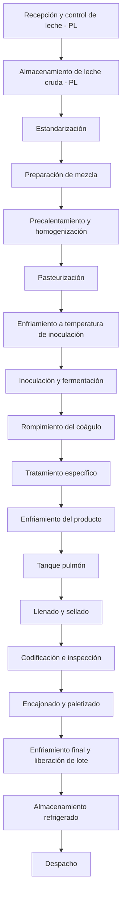
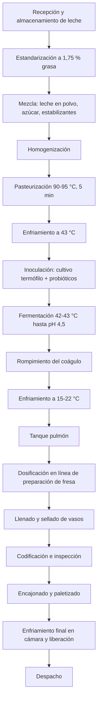
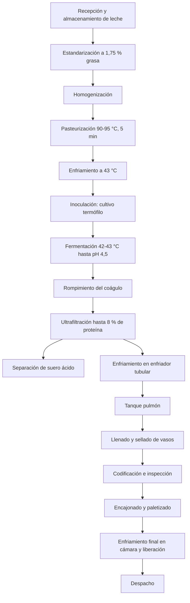
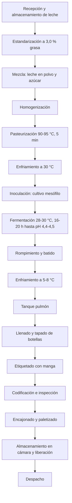
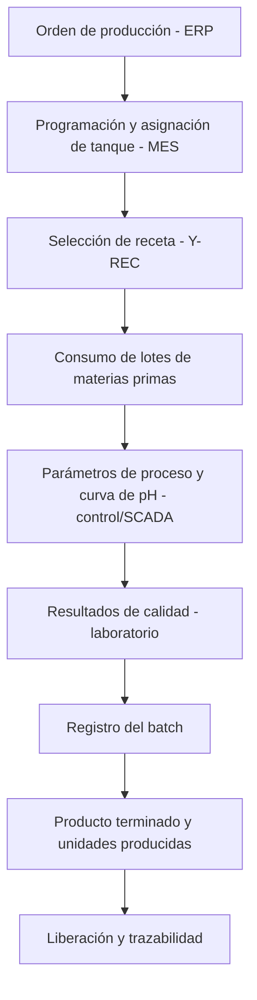
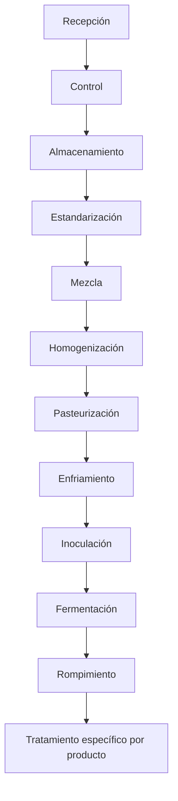
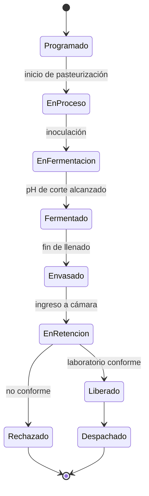

# Línea de Yogures y Leches Fermentadas — Modelo TDI

## Información general

**Proyecto:** Transformación Digital Industrial (TDI) — APM 2026-2S, entrega intermedia
**Empresa de referencia:** Alpina Productos Alimenticios S.A.S.
**Planta de referencia:** Sopó, Cundinamarca, Colombia
**Línea:** Yogures y leches fermentadas
**Código de línea:** `Y`

> **Nota:** La planta de Sopó se utiliza como referencia del modelo académico. La información interna de Alpina que no sea públicamente verificable no se presenta como dato real de la empresa. En esos casos se utilizan las etiquetas `REFERENCE`, `ASSUMED`, `CALCULATED` o `PROPOSED`.

---

# Estructura de modelamiento

| Capa | Descripción            | Estado                         |
| ---- | ---------------------- | ------------------------------ |
| 1    | Contexto               | 🟢 Definida                    |
| 2    | Materias primas        | 🟢 Definida                    |
| 3    | Flujo general          | 🟢 Definida                    |
| 4    | Proceso detallado      | 🟢 Definida                    |
| 5    | Equipos                | 🟢 Definida (preliminar)       |
| 6    | Variables              | 🟢 Definida                    |
| 7    | Sensores y actuadores  | 🟢 Definida (preliminar)       |
| 8    | Tiempos                | 🟢 Definida (valores de referencia y supuestos) |
| 9    | Capacidades            | 🟢 Definida (preliminar)       |
| 10   | Recursos               | 🟡 Parcial — consumos de servicios pendientes (Módulo 3) |
| 11   | Recetas                | 🟢 Definida                    |
| 12   | Batches y trazabilidad | 🟢 Definida                    |

---

# Convenciones

## Origen de los datos

| Etiqueta     | Significado                                              |
| ------------ | -------------------------------------------------------- |
| `PUBLIC`     | Información pública verificable de la empresa o normativa colombiana |
| `REFERENCE`  | Información proveniente de literatura o fuentes técnicas |
| `ASSUMED`    | Supuesto establecido para el modelo académico            |
| `CALCULATED` | Resultado obtenido mediante cálculo                      |
| `PROPOSED`   | Elemento propuesto por el proyecto                       |
| `PENDING`    | Registro definido cuyo valor aún no se ha obtenido       |

### Regla

> Ningún dato numérico debe aparecer sin indicar unidad + origen/estado.

**Unidades:** se usa el estándar común del proyecto. Producción en `kg/lote` (unidades/lote como dato complementario). Para la leche se asume densidad ≈ 1,03 kg/L y, por simplicidad, la capacidad de equipos de flujo se expresa en kg/h (`ASSUMED`).

## Sistema de identificación

| Elemento          | Código      |
| ----------------- | ----------- |
| Producto          | `Y-PRD-XXX` |
| Operación         | `Y-OP-XXX`  |
| Equipo            | `Y-EQ-XXX`  |
| Variable          | `Y-VAR-XXX` |
| Sensor            | `Y-SEN-XXX` |
| Actuador          | `Y-ACT-XXX` |
| Receta            | `Y-REC-XXX` |
| Recurso           | `Y-RES-XXX` |
| Materia prima     | `Y-MP-XXX`  |
| Material auxiliar | `Y-MA-XXX`  |
| Tiempo            | `Y-TMP-XXX` |
| Capacidad         | `Y-CAP-XXX` |
| Subproducto       | `Y-SUB-XXX` |

Los elementos compartidos de planta usan el prefijo `PL` (`PL-EQ-XXX`, `PL-RES-XXX`), con los mismos códigos que las líneas de Quesos y UHT. Los identificadores son únicos y no se reutilizan.

---

# Capa 1 — Contexto

## Empresa

**Alpina Productos Alimenticios S.A.S.**

## Planta de referencia

**Sopó, Cundinamarca, Colombia.** Se usa la misma planta de referencia de las líneas de Quesos y UHT para que el modelo integrado sea coherente. Los parámetros definidos no corresponden necesariamente a la operación real de Alpina.

## Línea de producción

**Línea:** Yogures y leches fermentadas · **Código:** `Y`

La línea se llama "yogures **y leches fermentadas**" porque el kumis, según la norma colombiana, no es yogur: se coagula con cultivos distintos (*Lactococcus lactis*), pero ambos son leches fermentadas (Res. 2310 de 1986, art. 10 — `PUBLIC`) y se elaboran con los mismos equipos.

```text
Recepción de materias primas
        ↓
Preparación y tratamiento térmico (continuo)
        ↓
Fermentación (batch)
        ↓
Envasado, inspección y embalaje (discreto)
        ↓
Almacenamiento refrigerado
        ↓
Despacho
```

La línea integra los tres tipos de operación que pide el proyecto: **continuas** (estandarización, homogenización, pasteurización, enfriamiento), **por lotes** (mezcla, fermentación, concentración) y **discretas** (llenado, sellado, codificación, inspección, encajonado, paletizado).

## Productos seleccionados

| ID          | Producto | Categoría | Presentación de referencia | Origen/Estado |
| ----------- | -------- | --------- | -------------------------- | ------------- |
| `Y-PRD-001` | Yogur semidescremado sabor fresa con trozos de fruta (tipo Alpina Original) | Yogur batido con fruta | Vaso 150 g | `PUBLIC` |
| `Y-PRD-002` | Yogur griego natural (tipo Alpina Griego) | Leche fermentada concentrada | Vaso 150 g | `PUBLIC` (producto y gramaje) / `ASSUMED` (sabor natural) |
| `Y-PRD-003` | Kumis dulce entero (tipo Kumis Alpina) | Leche fermentada mesófila | Botella 200 g | `PUBLIC` (producto y gramaje) / `ASSUMED` (envase botella) |

### Justificación de selección

Las tres referencias se diferencian de forma no trivial, como exige la guía del proyecto:

| Aspecto | Y-PRD-001 Yogur fresa | Y-PRD-002 Yogur griego | Y-PRD-003 Kumis |
|---|---|---|---|
| Cultivo | Termófilo + probióticos | Termófilo | Mesófilo |
| Temperatura de fermentación | 42–43 °C | 42–43 °C | 28–30 °C |
| Duración de fermentación | 4–5 h | 4–5 h | 16–20 h |
| Etapa exclusiva | Dosificación de preparación de fruta | Concentración por ultrafiltración | — (fermentación larga) |
| Ingredientes | Leche, leche en polvo, azúcar, estabilizantes, fruta, aditivos | Solo leche y cultivo | Leche, leche en polvo, azúcar |
| Rendimiento | > 1 kg de producto por kg de base (se suma la fruta) | ≈ 0,37 kg de producto por kg de base | 1 kg/kg |
| Subproducto | — | Suero ácido / permeado | — |
| Envase y máquina | Vaso 150 g, llenadora de vasos | Vaso 150 g, llenadora de vasos | Botella 200 g, llenadora de botellas |
| Inspección y trazabilidad | Proporción de fruta, lote de la preparación de fruta | Proteína ≥ 8 %, factor de concentración | Acidez 0,60–1,20 %, tiempo largo de tanque |

Origen de los parámetros: ver Capas 4 y 11.

```text
Yogur fresa   → fermentación termófila corta → rompimiento → enfriamiento → + fruta en línea → vaso
Yogur griego  → fermentación termófila corta → rompimiento → ultrafiltración (–suero) → enfriamiento → vaso
Kumis         → fermentación mesófila larga  → rompimiento → enfriamiento → botella
```

### Requisitos normativos por referencia

| Requisito | Y-PRD-001 Yogur semidescremado | Y-PRD-002 Yogur griego | Y-PRD-003 Kumis entero | Origen |
|---|---|---|---|---|
| Cultivo obligatorio | *S. thermophilus* + *L. delbrueckii* subsp. *bulgaricus* | *S. thermophilus* + *L. delbrueckii* subsp. *bulgaricus* | *Streptococcus* (hoy *Lactococcus*) *lactis* o *cremoris* | `PUBLIC` (Res. 2310/1986, arts. 11 y 14) |
| Materia grasa | ≥ 1,5 % m/m | < 15 % | ≥ 2,5 % m/m | `PUBLIC` (Res. 2310 art. 13; ficha ICBF) / `REFERENCE` (Codex 243) |
| Sólidos lácteos no grasos | ≥ 7,0 % m/m | ≥ 7,0 % m/m | ≥ 7,0 % m/m | `PUBLIC` (Res. 2310 art. 13) |
| Proteína láctea | ≥ 2,6 % m/m | **≥ 5,6 %** (leche fermentada concentrada) | ≥ 2,6 % m/m | `PUBLIC` (NTC 805, ficha ICBF) / `REFERENCE` (Codex 243, secc. 2.2) |
| Acidez (como ácido láctico) | 0,70–1,50 % m/m | 0,70–1,50 % m/m | 0,60–1,20 % m/m | `PUBLIC` (Res. 2310 arts. 13 y 16) |
| Fruta neta | ≥ 3 % m/m | — | — | `PUBLIC` (Res. 2310 art. 20) |
| Cultivo viable en producto final | ≥ 10⁷ UFC/g | ≥ 10⁷ UFC/g | ≥ 10⁷ UFC/g | `REFERENCE` (Codex 243, secc. 3.3) |
| Proteína objetivo del diseño | — | 8 % | — | `ASSUMED` (rango comercial 6–10 %) |
| Almacenamiento y vida útil | 4 °C · 15–21 días | 4 °C · 15–21 días | 4 °C · 15–21 días | `PUBLIC` (fichas técnicas ICBF) |

A diferencia de la línea UHT, los tres productos requieren **cadena de frío** desde el envasado hasta el despacho y no tienen cuarentena de esterilidad comercial.

## Mezcla de producción

El plan diario base (Capa 9) produce en masa: **Y-PRD-001 56 % · Y-PRD-002 12 % · Y-PRD-003 32 %** (`CALCULATED` a partir de 3, 2 y 2 lotes diarios). Esta cifra reemplaza el supuesto inicial de 50/20/30. El griego pesa menos en masa porque rinde ≈ 0,37 kg por kg de base, aunque ocupa dos lotes al día.

## Alcance del modelo

### Dentro del alcance

Materias primas, operaciones de transformación, equipos, variables, sensores, actuadores, tiempos, capacidades, recursos, recetas, batches, trazabilidad, almacenamiento refrigerado, gestión del subproducto (suero ácido) e interacción con recursos compartidos de planta.

```text
Recepción de materias primas → Proceso productivo → Producto terminado → Almacenamiento refrigerado → Despacho
```

### Fuera del alcance inmediato

Transporte externo, distribución nacional, puntos de venta, consumidor, comercialización, cadena logística externa y elaboración de la preparación de fruta (se compra a un proveedor).

---

# Capa 2 — Materias primas

## Materias primas principales

| ID | Materia prima / insumo | Unidad | Función | Fresa | Griego | Kumis | Origen/Estado |
|---|---|---|---|---|---|---|---|
| `Y-MP-001` | Leche de vaca | kg | Materia prima principal | ✓ | ✓ | ✓ | `REFERENCE` |
| `Y-MP-002` | Leche en polvo descremada | kg | Aumentar sólidos no grasos y firmeza | ✓ | — | ✓ | `PUBLIC` (en etiqueta) / `REFERENCE` (dosis) |
| `Y-MP-003` | Azúcar | kg | Endulzar | ✓ | — | ✓ | `PUBLIC` (en etiqueta) / `ASSUMED` (dosis) |
| `Y-MP-004` | Estabilizantes (almidón modificado, gelatina, pectina) | kg | Textura y estabilidad del batido | ✓ | — | — | `PUBLIC` (en etiqueta) / `REFERENCE` (dosis) |
| `Y-MP-005` | Preparación de fresa con trozos | kg | Sabor, fruta y color | ✓ | — | — | `PUBLIC` (en etiqueta) / `ASSUMED` (dosis) |
| `Y-MP-006` | Aditivos menores (aroma de fresa, carmín, achiote, sucralosa) | kg | Sabor, color y edulcoración | ✓ | — | — | `PUBLIC` (en etiqueta) |
| `Y-MP-007` | Cultivo termófilo de yogur (*S. thermophilus* + *L. bulgaricus*) | UC / lote | Fermentación | ✓ | ✓ | — | `PUBLIC` (cultivo) |
| `Y-MP-008` | Cultivo probiótico (*L. acidophilus*, *L. casei*) | UC / lote | Valor funcional | ✓ | — | — | `PUBLIC` (en etiqueta) |
| `Y-MP-009` | Cultivo mesófilo de kumis (*Lactococcus lactis* subsp. *lactis* / *cremoris*) | UC / lote | Fermentación | — | — | ✓ | `PUBLIC` (Res. 2310 art. 14) |

> Los cultivos (Y-MP-007 a 009) se compran liofilizados o congelados para adición directa (DVS). La dosis se expresa en unidades de cultivo (UC) por lote según la ficha del proveedor (`ASSUMED`); su masa es despreciable en el balance.

## `Y-MP-001` — Leche de vaca

Materia prima base de las tres referencias. Se recibe en el sistema compartido de planta (`PL-EQ-001`) y se estandariza en la línea:

| Parámetro | Unidad | Valor | Origen |
|---|---|---|---|
| Temperatura de recepción | °C | ≤ 7 | `REFERENCE` (mismo criterio de la línea UHT) |
| Grasa de la leche cruda | % | 3,5 | `ASSUMED` |
| Grasa estandarizada — Y-PRD-001 y 002 | % | 1,5–2,0 (objetivo 1,75) | `ASSUMED` (sobre el mínimo legal de 1,5 % del yogur semidescremado) |
| Grasa estandarizada — Y-PRD-003 | % | 3,0 | `ASSUMED` (sobre el mínimo legal de 2,5 %) |

Características que se convierten en variables de calidad: temperatura, acidez, pH, grasa, proteína, sólidos totales, carga microbiológica, antibióticos y volumen recibido.

## Fórmula base por 1.000 kg de producto terminado

| Ingrediente | Y-PRD-001 Yogur fresa (kg) | Y-PRD-002 Griego (kg) | Y-PRD-003 Kumis (kg) |
|---|---|---|---|
| Y-MP-001 Leche estandarizada | 765 | 2.700 | 920 |
| Y-MP-002 Leche en polvo descremada | 25 | — | 10 |
| Y-MP-003 Azúcar | 55 | — | 70 |
| Y-MP-004 Estabilizantes | 5 | — | — |
| Y-MP-005 Preparación de fresa | 150 | — | — |
| Y-MP-006 a 009 (cultivos y aditivos menores) | < 1 | < 1 | < 1 |
| **Total de entrada** | **1.000** | **2.700** | **1.000** |
| Subproducto Y-SUB-001 (suero ácido / permeado) | — | 1.700 | — |
| Origen | `ASSUMED` | `CALCULATED` | `ASSUMED` |

**Comprobaciones:**
- Fruta neta del Y-PRD-001: la preparación tiene ≈ 30–40 % de fruta (`ASSUMED`), así que 15 % de preparación aporta 4,5–6 % de fruta neta, por encima del 3 % legal. La dosis de 15 % está en el rango industrial de 7–15 % (`REFERENCE`, Tetra Pak).
- Estabilizantes del Y-PRD-001: 0,5 %, igual al límite legal de gelificantes de 5 g/kg (Res. 2310 art. 19 — `PUBLIC`).
- Griego (`CALCULATED`): con ultrafiltración, 1.000 L de leche con 3 % de proteína rinden 300 L de concentrado al 10 % (3,3:1) o 500 L al 6 % (2:1) (Tetra Pak). En planta piloto se alcanzaron 2,8–2,9× para ≈ 10 % de proteína (Paredes Valencia et al., 2018). Interpolando para 8 % de proteína: **≈ 2,7 kg de base fermentada por kg de griego** y 1,7 kg de permeado ácido.

## Subproductos

| ID | Subproducto | Origen | Cantidad | Origen/Estado | Destino |
|---|---|---|---|---|---|
| `Y-SUB-001` | Permeado / suero ácido | Ultrafiltración del griego | 1,7 kg por kg de griego | `CALCULATED` | Tanque de suero (Y-EQ-022); disposición o venta (por definir en planta) |
| `Y-SUB-002` | Crema | Estandarización de la leche | ≈ 1.000 kg/día (Capa 10) | `CALCULATED` | Recurso de planta; candidata a uso en otras líneas |

---

# Materiales auxiliares y de empaque

| ID | Material | Unidad | Por 1.000 kg de producto | Aplica a | Función | Origen/Estado |
|---|---|---|---|---|---|---|
| `Y-MA-001` | Vaso termoformado impreso 150 g | unidad | 6.667 | Y-PRD-001, 002 | Empaque primario | `CALCULATED` / `ASSUMED` (material) |
| `Y-MA-002` | Tapa de aluminio termosellable | unidad | 6.667 | Y-PRD-001, 002 | Cierre hermético | `CALCULATED` |
| `Y-MA-003` | Botella PEAD 200 g con tapa | unidad | 5.000 | Y-PRD-003 | Empaque primario | `CALCULATED` / `ASSUMED` (material) |
| `Y-MA-004` | Etiqueta tipo manga termoencogible | unidad | 5.000 | Y-PRD-003 | Identificación | `ASSUMED` (los vasos van impresos y no la necesitan) |
| `Y-MA-005` | Tinta o ribbon de codificación | — | Según codificador | Las 3 | Lote y fecha de vencimiento | `PROPOSED` |
| `Y-MA-006` | Caja corrugada de 24 unidades | caja | 278 (vasos) · 209 (botellas) | Las 3 | Empaque secundario | `ASSUMED` (24 un/caja) / `CALCULATED` |
| `Y-MA-007` | Estiba y película estirable | estiba | 1 cada 100 cajas | Las 3 | Empaque terciario | `ASSUMED` |

---

# Relación Producto → Receta → Batch

```text
PRODUCTO (qué se fabrica)  →  RECETA (cómo se fabrica)  →  BATCH (ejecución concreta)
Y-PRD-001                     Y-REC-001                    20261013-Y-001-001
```

El detalle de las recetas está en la Capa 11 y el de los batches en la Capa 12.

---

# Capa 3 — Flujo general

La línea se modela como un **flujo común con rutas diferenciadas** después de la fermentación. Los parámetros de cada operación se detallan en la Capa 4.

## Flujo general de la línea



## Ruta — Yogur fresa (Y-PRD-001)



## Ruta — Yogur griego (Y-PRD-002)



## Ruta — Kumis (Y-PRD-003)



## Entradas

| Tipo | Elementos |
|---|---|
| Materias primas | Leche, leche en polvo, azúcar, estabilizantes, preparación de fruta, aditivos, cultivos |
| Materiales de empaque | Vasos, tapas de aluminio, botellas, mangas, tinta de codificación, cajas, estibas |
| Servicios industriales | Vapor o agua caliente, agua helada, refrigeración de cámaras, aire comprimido, agua, electricidad, CIP |

## Salidas

- **Producto terminado:** vasos de yogur fresa y griego, botellas de kumis.
- **Subproductos:** suero ácido del griego (Y-SUB-001) y crema de la estandarización (Y-SUB-002).
- **Residuos:** producto rechazado en inspección, mermas de arranque y cambio, envases defectuosos y efluentes de CIP.
- **Información de producción:** lotes de materias primas, parámetros reales, curvas de fermentación, resultados de calidad, paradas y cantidades producidas.

## Flujo de información



## Puntos de almacenamiento identificados

| Punto | Función | Temperatura | Estado |
|---|---|---|---|
| Silos de leche cruda (`PL-EQ-001`) | Conservación de materia prima | ≤ 4 °C | `PROPOSED` (compartido) |
| Bodega de secos | Leche en polvo, azúcar, estabilizantes, empaques | Ambiente | `PROPOSED` |
| Cámara de insumos refrigerados | Preparación de fruta y cultivos | Fruta ≤ 8 °C, cultivos según proveedor | `PROPOSED` |
| Tanques de fermentación | Fermentación y espera hasta el enfriamiento | 30–43 °C | `PROPOSED` |
| Tanques pulmón | Producto fermentado y frío antes del llenado | 5–22 °C | `PROPOSED` |
| Tanque de suero ácido | Subproducto del griego | ≤ 8 °C | `PROPOSED` |
| Cámara fría de producto terminado | Enfriamiento final, retención y despacho | 2–4 °C | `PROPOSED` |

## Consideraciones del flujo

- La línea comparte una **secuencia común hasta la fermentación**. Después se separa en tres rutas: fruta en línea (fresa), ultrafiltración (griego) y envase en botella (kumis).
- El **tanque de fermentación es el equipo batch central**. El kumis lo ocupa unas 20 h, más de dos veces lo que lo ocupa un lote de yogur (Capa 8).
- La **llenadora de vasos** atiende dos de las tres referencias y es el principal candidato a cuello de botella (Capa 9).
- El flujo físico y el de información se vinculan mediante el ID de batch.
- Las rutas son el modelo académico propuesto; no necesariamente la secuencia interna de Alpina.

## Estado de la capa

| Elemento | Estado |
|---|---|
| Flujo general | 🟢 Definido |
| Rutas por producto | 🟢 Definidas |
| Entradas y salidas | 🟢 Identificadas |
| Flujo de información | 🟢 Definido conceptualmente |
| Puntos de almacenamiento | 🟢 Identificados |

---

# Capa 4 — Proceso detallado

Esta capa descompone el flujo en operaciones identificables, con entradas, salidas y parámetros. Los parámetros salen de literatura técnica (Tetra Pak Dairy Processing Handbook, estudios de ultrafiltración, estudios de elaboración de kumis) y de la normativa colombiana. No se asumen como parámetros internos de Alpina.

## Process Master

| ID | Operación | Entrada principal | Salida principal | Producto | Tipo | Origen/Estado |
|---|---|---|---|---|---|---|
| Y-OP-001 | Recepción de leche | Leche cruda | Leche recibida | Todos | Discreto | `REFERENCE` (compartida, `PL-EQ-001`) |
| Y-OP-002 | Control de recepción | Muestra de leche | Leche aprobada o rechazada | Todos | Discreto | `REFERENCE` |
| Y-OP-003 | Almacenamiento de leche cruda | Leche aprobada | Leche disponible | Todos | Buffer | `PROPOSED` (compartida) |
| Y-OP-004 | Estandarización de grasa | Leche cruda | Leche estandarizada + crema | Todos | Continuo | `REFERENCE` |
| Y-OP-005 | Preparación de mezcla | Leche + polvos | Mezcla base | Fresa, Kumis | Batch | `REFERENCE` |
| Y-OP-006 | Precalentamiento y homogenización | Mezcla base | Mezcla homogenizada | Todos | Continuo | `REFERENCE` |
| Y-OP-007 | Pasteurización | Mezcla homogenizada | Mezcla pasteurizada | Todos | Continuo | `REFERENCE` |
| Y-OP-008 | Enfriamiento a temperatura de inoculación | Mezcla pasteurizada | Mezcla a 43 o 30 °C | Todos | Continuo | `REFERENCE` |
| Y-OP-009 | Inoculación | Mezcla + cultivo | Mezcla inoculada | Todos | Batch | `REFERENCE` |
| Y-OP-010 | Fermentación | Mezcla inoculada | Coágulo ácido | Todos | Batch | `REFERENCE` |
| Y-OP-011 | Rompimiento del coágulo | Coágulo | Producto fermentado batido | Todos | Batch | `REFERENCE` |
| Y-OP-012 | Concentración por ultrafiltración | Yogur base | Griego + permeado | Griego | Batch / semicontinuo | `REFERENCE` |
| Y-OP-013 | Enfriamiento del producto | Producto fermentado | Producto frío | Todos | Continuo | `REFERENCE` |
| Y-OP-014 | Almacenamiento en tanque pulmón | Producto frío | Producto listo para llenar | Todos | Buffer | `PROPOSED` |
| Y-OP-015 | Dosificación de preparación de fruta | Yogur + preparación de fresa | Yogur con fruta | Fresa | Continuo | `REFERENCE` |
| Y-OP-016 | Llenado y sellado de vasos | Producto + vasos + tapas | Vasos sellados | Fresa, Griego | Discreto | `REFERENCE` |
| Y-OP-017 | Llenado y tapado de botellas | Producto + botellas | Botellas cerradas | Kumis | Discreto | `REFERENCE` |
| Y-OP-018 | Etiquetado con manga | Botellas | Botellas etiquetadas | Kumis | Discreto | `ASSUMED` |
| Y-OP-019 | Codificación e inspección | Unidades envasadas | Unidades conformes + rechazos | Todos | Discreto | `PROPOSED` |
| Y-OP-020 | Encajonado | Unidades conformes | Cajas de 24 | Todos | Discreto, manual (base) | `ASSUMED` |
| Y-OP-021 | Paletizado | Cajas | Estibas | Todos | Discreto, manual (base) | `ASSUMED` |
| Y-OP-022 | Enfriamiento final y liberación de lote | Estibas | Producto liberado o rechazado | Todos | Espera | `REFERENCE` / `ASSUMED` |
| Y-OP-023 | Almacenamiento de producto terminado | Producto liberado | Producto disponible | Todos | Buffer | `PROPOSED` |
| Y-OP-024 | Despacho | Producto terminado | Producto despachado | Todos | Discreto | `PROPOSED` |
| Y-OP-025 | Gestión de suero ácido | Permeado | Suero almacenado o retirado | Griego | Buffer | `PROPOSED` |
| Y-OP-026 | Limpieza CIP | Equipos sucios | Equipos limpios | Todos | Batch (compartido `PL-EQ-002`) | `REFERENCE` |

## Parámetros por operación

| ID | Operación | Variable | Unidad | Valor | Aplica a | Origen |
|---|---|---|---|---|---|---|
| Y-VAR-001 | Y-OP-001 | Temperatura de recepción | °C | ≤ 7 | Todos | `REFERENCE` |
| Y-VAR-002 | Y-OP-004 | Grasa estandarizada | % | 1,5–2,0 (fresa, griego) · 3,0 (kumis) | Según producto | `ASSUMED` |
| Y-VAR-003 | Y-OP-005 | Sólidos totales de la mezcla | % | 14–16 | Fresa, Kumis | `REFERENCE` |
| Y-VAR-004 | Y-OP-006 | Temperatura de homogenización | °C | 65–70 | Todos | `REFERENCE` (Tetra Pak) |
| Y-VAR-005 | Y-OP-006 | Presión de homogenización | bar | 200–250 | Todos | `REFERENCE` (Tetra Pak) |
| Y-VAR-006 | Y-OP-007 | Temperatura de pasteurización | °C | 90–95 | Todos | `REFERENCE` (Tetra Pak) |
| Y-VAR-007 | Y-OP-007 | Tiempo de retención | min | 5 | Todos | `REFERENCE` (Tetra Pak) |
| Y-VAR-008 | Y-OP-008 a 010 | Temperatura de inoculación y fermentación | °C | 42–43 (yogures) · 28–30 (kumis) | Según producto | `REFERENCE` (Tetra Pak; estudio de kumis ULEAM) |
| Y-VAR-009 | Y-OP-010 | Tiempo de fermentación | h | 4–5 (yogures) · 16–20 (kumis) | Según producto | `REFERENCE` |
| Y-VAR-010 | Y-OP-010 | pH de fin de fermentación | — | 4,5 (yogures, rango 4,2–4,6) · 4,4–4,5 (kumis) | Según producto | `REFERENCE` |
| Y-VAR-011 | Y-OP-011 | Velocidad de agitación en rompimiento | rpm | Baja, según agitador (sin incorporar aire) | Todos | `REFERENCE` |
| Y-VAR-012 | Y-OP-012 | Temperatura de ultrafiltración | °C | ≈ 50 | Griego | `REFERENCE` (ensayo piloto; validar viabilidad del cultivo) |
| Y-VAR-013 | Y-OP-012 | Presión transmembrana | bar | ≈ 5,5 | Griego | `REFERENCE` (551 kPa, ensayo piloto) |
| Y-VAR-014 | Y-OP-012 | Factor de concentración / proteína del retenido | — / % | 2,7 / ≥ 8 | Griego | `CALCULATED` / `ASSUMED` |
| Y-VAR-015 | Y-OP-013 | Temperatura de salida del enfriador | °C | 15–22 (fresa) · 10–15 (griego) · 5–8 (kumis) | Según producto | `REFERENCE` (Tetra Pak, yogur batido y kéfir) / `ASSUMED` (griego) |
| Y-VAR-016 | Y-OP-014 | Nivel de tanque pulmón | % | 10–90 | Todos | `ASSUMED` |
| Y-VAR-017 | Y-OP-015 | Proporción de preparación de fruta | % m/m | 15 ± 0,5 | Fresa | `ASSUMED` |
| Y-VAR-018 | Y-OP-016, 017 | Peso neto de llenado | g | 150 (vaso) · 200 (botella), tolerancia ± 2 % | Según producto | `PUBLIC` (gramaje) / `ASSUMED` (tolerancia) |
| Y-VAR-019 | Y-OP-016, 017 | Integridad de sellado o tapado | — | Pasa / no pasa | Todos | `ASSUMED` |
| Y-VAR-020 | Y-OP-019 | Legibilidad del código de lote y vencimiento | — | Pasa / no pasa | Todos | `PROPOSED` |
| Y-VAR-021 | Y-OP-022 | Temperatura de producto al final del enfriamiento | °C | ≤ 5 | Todos | `REFERENCE` (Tetra Pak) |
| Y-VAR-022 | Y-OP-022 | Acidez del producto terminado | % ácido láctico | 0,70–1,50 (yogures) · 0,60–1,20 (kumis) | Según producto | `PUBLIC` (Res. 2310) |
| Y-VAR-023 | Y-OP-023 | Temperatura de cámara fría | °C | 2–4 | Todos | `PUBLIC` (ICBF, ≤ 4 °C) |
| Y-VAR-024 | Y-OP-025 | Nivel de tanque de suero | % | 10–90 | Griego | `ASSUMED` |
| Y-VAR-025 | Y-OP-026 | Temperatura y concentración de soluciones CIP | °C / % | Según programa del sistema CIP | Todos | `PENDING` (compartido) |

## Proceso común



El tratamiento térmico a 90–95 °C por 5 min desnaturaliza las proteínas del suero. Eso mejora la retención de agua y la firmeza del coágulo, y además elimina la flora competidora antes de inocular. La homogenización evita que la grasa se separe y mejora la viscosidad (Tetra Pak — `REFERENCE`).

## Ruta de proceso — Yogur fresa (Y-PRD-001)

**Características de modelamiento:**
- Yogur **batido**: fermenta en tanque y se rompe el coágulo antes de enfriar y envasar.
- Se enfría suavemente a 15–22 °C para no perder viscosidad. El enfriamiento final hasta ≤ 5 °C ocurre en la cámara fría.
- La preparación de fresa se dosifica **en línea** (bomba dosificadora y mezclador estático) justo antes de la llenadora. El yogur base se mantiene blanco y el cambio de sabor afecta solo al tramo final.
- Lleva probióticos, que se inoculan con el cultivo termófilo.

## Ruta de proceso — Yogur griego (Y-PRD-002)

**Características de modelamiento:**
- Misma fermentación que el yogur fresa, sin polvos ni azúcar. La concentración se logra retirando suero, no agregando sólidos.
- La **ultrafiltración** posterior a la fermentación es la operación diferenciadora. Por cada kg de griego se procesan ≈ 2,7 kg de base y se generan ≈ 1,7 kg de permeado ácido.
- Su alta viscosidad exige un **enfriador tubular** en lugar del de placas.
- Variables críticas: proteína del retenido, factor de concentración, presión transmembrana y temperatura.

## Ruta de proceso — Kumis (Y-PRD-003)

**Características de modelamiento:**
- Fermentación **mesófila** a 28–30 °C durante 16–20 h hasta pH 4,4–4,5 (`REFERENCE`, estudio de elaboración de kumis con *Lactococcus lactis*, 90 °C de tratamiento e incubación de 20 h).
- El producto es semilíquido. Se bate después de coagular y se enfría a 5–8 °C antes de envasar.
- Envasado en **botella** en una máquina distinta de la llenadora de vasos, más etiquetado con manga.
- Variable crítica: la acidez final (0,60–1,20 %). Si se pasa de fermentación, el producto sale de especificación.

## Estado de la información

| Tipo de información | Estado |
|---|---|
| Secuencia de operaciones | 🟢 Definida |
| Diferenciación por producto | 🟢 Definida |
| Parámetros de proceso | 🟢 Definidos con referencias; los `ASSUMED` deben validarse |
| CIP (programas y tiempos) | 🟡 Pendiente de integración de planta |

---

# Capa 5 — Equipos

## 1. Objetivo

Identificar los equipos asociados a las operaciones de la línea, su función, las operaciones que soportan y sus características técnicas. Es una propuesta de modelamiento académico, no un inventario verificado de Sopó.

## 2. Inventario de equipos

| ID | Equipo | Operación | Capacidad / característica | Productos | Compartido | Origen/Estado |
|---|---|---|---|---|---|---|
| PL-EQ-001 | Sistema de recepción, filtración y silos de leche cruda | Y-OP-001 a 003 | Según planta | Todos | Sí | `REFERENCE` |
| Y-EQ-001 | Separadora centrífuga estandarizadora | Y-OP-004 | 6.000 kg/h | Todos | No | `ASSUMED` |
| Y-EQ-002 | Tanque de mezcla con mezclador de polvos de alta cizalla y celdas de carga | Y-OP-005 | 5.000 L | Fresa, Kumis | No | `ASSUMED` |
| Y-EQ-003 | Pasteurizador de placas con desaireador, regeneración y tubo de retención de 5 min | Y-OP-006 a 008 | 5.000 kg/h, 90–95 °C | Todos | No | `REFERENCE` (configuración Tetra Pak) / `ASSUMED` (capacidad) |
| Y-EQ-004 | Homogeneizador | Y-OP-006 | 5.000 kg/h, hasta 250 bar | Todos | No | `REFERENCE` / `ASSUMED` (capacidad) |
| Y-EQ-005 a Y-EQ-009 | Tanques de fermentación encamisados con agitador (5 unidades) | Y-OP-009 a 011 | 5.000 L nominales · 4.000 kg útiles por lote | Todos | No | `ASSUMED` |
| Y-EQ-010 | Unidad de ultrafiltración (membrana espiral) | Y-OP-012 | 2.000 kg/h de alimentación | Griego | No | `ASSUMED` |
| Y-EQ-011 | Enfriador de placas de trato suave | Y-OP-013 | 8.000 kg/h (vacía un tanque en ≈ 30 min) | Fresa, Kumis | No | `REFERENCE` (vaciado en 30 min, Tetra Pak) / `CALCULATED` |
| Y-EQ-012 | Enfriador tubular para producto viscoso | Y-OP-013 | En línea con la UF, 750 kg/h de retenido | Griego | No | `ASSUMED` |
| Y-EQ-013 / Y-EQ-014 | Tanques pulmón asépticos (2 unidades) | Y-OP-014 | 6.000 L cada uno | Todos | No | `ASSUMED` |
| Y-EQ-015 | Dosificador de fruta (bomba de lóbulos) con mezclador estático | Y-OP-015 | Proporcional al caudal de llenado | Fresa | No | `REFERENCE` |
| Y-EQ-016 | Llenadora-selladora de vasos preformados, 6 carriles | Y-OP-016 | 10.800 vasos/h (1.620 kg/h) | Fresa, Griego | No | `REFERENCE` (≈ 1.800 vasos/h por carril, Hamba 8 carriles = 14.400/h) / `ASSUMED` |
| Y-EQ-017 | Llenadora-tapadora de botellas | Y-OP-017 | 6.000 botellas/h (1.200 kg/h) | Kumis | No | `ASSUMED` |
| Y-EQ-018 | Etiquetadora de manga con túnel termoencogible | Y-OP-018 | ≥ 6.000 botellas/h | Kumis | No | `ASSUMED` |
| Y-EQ-019 | Codificadores inkjet (2 unidades, uno por llenadora) | Y-OP-019 | Velocidad de la llenadora | Todos | No | `PROPOSED` |
| Y-EQ-020 | Estación de encajonado | Y-OP-020 | Manual en el escenario base (candidata a celda robotizada) | Todos | No | `ASSUMED` |
| Y-EQ-021 | Estación de paletizado | Y-OP-021 | Manual con estibador en el escenario base (candidata a celda robotizada) | Todos | No | `ASSUMED` |
| Y-EQ-022 | Tanque de suero ácido | Y-OP-025 | 6.000 L (≥ 1 día de permeado) | Griego | No | `CALCULATED` (5.037 kg/día) / `ASSUMED` |
| Y-EQ-023 | Cámara fría de producto terminado | Y-OP-022, 023 | 2–4 °C, ≥ 3 días de producción (≈ 200 estibas) | Todos | Candidata a compartir con Quesos | `CALCULATED` / `ASSUMED` |
| Y-EQ-024 | Equipos de laboratorio (pH-metro, titulador de acidez, analizador de proteína/grasa, incubadoras de microbiología) | Y-OP-002, 022 | Según muestras por lote | Todos | Candidato a compartir (laboratorio de planta) | `ASSUMED` |
| PL-EQ-002 | Sistema CIP compartido | Y-OP-026 | — | Todos | Sí | `REFERENCE` |
| PL-EQ-003 | Generación de vapor / agua caliente | Y-OP-007, camisas de tanques | — | Todos | Sí | `ASSUMED` |
| PL-EQ-004 | Agua helada / refrigeración | Y-OP-008, 013, cámaras | — | Todos | Sí | `ASSUMED` |
| PL-EQ-005 | Aire comprimido | Válvulas neumáticas, llenadoras, rechazadores | — | Todos | Sí | `ASSUMED` |

## 3. Características técnicas que debemos registrar

| Característica | Unidad estándar | Utilidad |
|---|---|---|
| Capacidad de procesamiento | kg/h | Estimar el flujo de producción |
| Capacidad por lote | kg/lote | Relacionar el equipo con el batch |
| Tiempo de operación | min o h | Duración y utilización |
| Temperatura de operación | °C | Condiciones térmicas |
| Presión de operación | bar | Homogeneizador, UF, servicios |
| Potencia instalada | kW | Requerimientos eléctricos (Módulo 3) |
| Consumo energético | kWh | Evaluación económica (Módulo 3) |
| Volumen útil | L | Tanques y cámaras |
| Servicios requeridos | Según servicio | Vapor, agua helada, aire, agua, CIP |

## 4. Relación entre equipos y operaciones

- El **tanque de fermentación** cubre inoculación, fermentación y rompimiento (Y-OP-009 a 011) y permanece ocupado hasta su vaciado y CIP.
- El **pasteurizador** integra precalentamiento, desaireación, retención y enfriamiento a la temperatura de inoculación, y alimenta al homogeneizador en su sección caliente.
- Las **dos llenadoras** son independientes: la de vasos atiende fresa y griego; la de botellas, kumis. Por eso pueden envasar kumis y yogur al mismo tiempo.
- La **cámara fría** puede ser compartida con la línea de Quesos (decisión de planta).

## 5. Información pendiente

| Información | Estado |
|---|---|
| Inventario real de equipos en Sopó | Pendiente de verificar |
| Fabricante y modelo | Pendiente (Módulo 3: cotizaciones) |
| Potencias y consumos | Pendiente (Módulo 3) |
| Capacidad real de recursos compartidos `PL-*` | Pendiente de consolidar con Quesos y UHT |

**Estado actual:** inventario completo a nivel de línea con capacidades de referencia o supuestas. Falta validar contra equipos reales y cotizaciones.

---

# Capa 6 — Variables

## 1. Objetivo

Identificar las variables de proceso relevantes para las tres referencias, su relación con operaciones y equipos, y su criticidad. Su inclusión no implica que hoy se midan en planta ni que todas requieran control automático.

## 2. Inventario de variables de proceso

Los valores objetivo de Y-VAR-001 a 025 están en la Capa 4. Aquí se clasifican por criticidad.

| ID | Variable | Unidad | Equipo | Criticidad | Medición en escenario base |
|---|---|---|---|---|---|
| Y-VAR-001 | Temperatura de recepción | °C | PL-EQ-001 | Calidad | Manual (laboratorio) |
| Y-VAR-002 | Grasa estandarizada | % | Y-EQ-001 | Calidad / legal | Manual (laboratorio) |
| Y-VAR-003 | Sólidos totales de la mezcla | % | Y-EQ-002 | Calidad (textura) | Manual (laboratorio) |
| Y-VAR-004 | Temperatura de homogenización | °C | Y-EQ-004 | Importante | Controlador local del equipo |
| Y-VAR-005 | Presión de homogenización | bar | Y-EQ-004 | Importante (textura) | Manómetro local |
| Y-VAR-006 | Temperatura de pasteurización | °C | Y-EQ-003 | **Crítica (inocuidad)** | Controlador local con registrador |
| Y-VAR-007 | Tiempo de retención | min | Y-EQ-003 | **Crítica (inocuidad)** | Fijo por diseño del tubo y caudal |
| Y-VAR-008 | Temperatura de fermentación | °C | Y-EQ-005 a 009 | **Crítica (calidad)** | Termómetro local por tanque |
| Y-VAR-009 | Tiempo de fermentación | h | Y-EQ-005 a 009 | Importante | Registro manual |
| Y-VAR-010 | pH de fin de fermentación | — | Y-EQ-005 a 009 | **Crítica (punto de corte)** | Muestreo manual cada 30–60 min |
| Y-VAR-011 | Velocidad de agitación | rpm | Y-EQ-005 a 009 | Importante (viscosidad) | Fija |
| Y-VAR-012 | Temperatura de UF | °C | Y-EQ-010 | Importante | Controlador local |
| Y-VAR-013 | Presión transmembrana | bar | Y-EQ-010 | Importante (rendimiento de membrana) | Controlador local |
| Y-VAR-014 | Proteína del retenido | % | Y-EQ-010 | **Crítica (legal ≥ 5,6 %)** | Manual (laboratorio) |
| Y-VAR-015 | Temperatura de salida del enfriador | °C | Y-EQ-011, 012 | Importante | Termómetro local |
| Y-VAR-016 | Nivel de tanque pulmón | % | Y-EQ-013, 014 | Importante (continuidad del llenado) | Visor / interruptor de nivel |
| Y-VAR-017 | Proporción de fruta | % m/m | Y-EQ-015 | **Crítica (legal ≥ 3 % de fruta neta)** | Ajuste manual de la bomba |
| Y-VAR-018 | Peso neto de llenado | g | Y-EQ-016, 017 | **Crítica (legal / metrológica)** | Muestreo manual con balanza |
| Y-VAR-019 | Integridad de sellado o tapado | — | Y-EQ-016, 017 | **Crítica (inocuidad)** | Inspección visual |
| Y-VAR-020 | Legibilidad del código | — | Y-EQ-019 | Trazabilidad | Inspección visual |
| Y-VAR-021 | Temperatura de producto en cámara | °C | Y-EQ-023 | **Crítica (cadena de frío)** | Termómetro manual por muestreo |
| Y-VAR-022 | Acidez del producto terminado | % | Laboratorio | Calidad / legal | Manual (laboratorio) |
| Y-VAR-023 | Temperatura de cámara | °C | Y-EQ-023 | **Crítica (cadena de frío)** | Termostato local |
| Y-VAR-024 | Nivel de tanque de suero | % | Y-EQ-022 | Operativa | Visor |
| Y-VAR-025 | Parámetros CIP | °C / % | PL-EQ-002 | Inocuidad | Sistema CIP de planta |

## 3. Variables específicas por producto

| Producto | Variables de especial interés | Justificación |
|---|---|---|
| Yogur fresa | pH final, proporción de fruta, temperatura de enfriamiento | Punto de corte de fermentación; fruta neta legal; viscosidad |
| Yogur griego | pH final, proteína del retenido, presión transmembrana | Cumplimiento ≥ 5,6 % de proteína; rendimiento de membrana |
| Kumis | Temperatura y tiempo de fermentación, acidez final | Fermentación larga con riesgo de sobreacidificación |

## 4. Clasificación según su función

| Categoría | Variables |
|---|---|
| Térmicas | Y-VAR-001, 004, 006, 008, 012, 015, 021, 023 |
| Fisicoquímicas | Y-VAR-002, 003, 010, 014, 022 |
| Mecánicas y operativas | Y-VAR-005, 007, 009, 011, 013, 016, 024 |
| Producción, envasado y trazabilidad | Y-VAR-017, 018, 019, 020 |

## 5. Registro de información y trazabilidad

Cada registro se asocia con: ID de variable, fecha y hora, valor y unidad, equipo u operación, ID de batch, producto y versión de receta, origen del dato (sensor, laboratorio, operario o cálculo) y estado (medido, estimado, calculado o pendiente).

**Estado:** inventario completo con rangos objetivo y criticidad. La columna "medición en escenario base" sirve de insumo para el diagnóstico inicial (Módulo 2) y para la arquitectura ISA-95 inicial.

---

# Capa 7 — Sensores y actuadores

## 1. Objetivo

Asociar cada variable con el instrumento que la mide y el elemento que actúa sobre ella, distinguiendo lo que existe en el escenario base de lo que propone el proyecto.

## 2. Sensores e instrumentos de medición

| ID | Sensor | Variable | Rango / tipo | Ubicación | Escenario base | Origen/Estado |
|---|---|---|---|---|---|---|
| Y-SEN-001 | RTD Pt100 sanitaria | Y-VAR-006 | 0–150 °C | Salida del tubo de retención (Y-EQ-003) | Existe (control local) | `REFERENCE` |
| Y-SEN-002 | RTD Pt100 sanitaria | Y-VAR-004, 015 | 0–100 °C | Homogeneizador y salida de enfriadores | Existe parcialmente | `PROPOSED` |
| Y-SEN-003 | Caudalímetro electromagnético | Caudal de mezcla (garantiza Y-VAR-007) | 0–8.000 kg/h | Entrada del pasteurizador | No existe | `PROPOSED` |
| Y-SEN-004 | Transmisor de presión sanitario | Y-VAR-005 | 0–300 bar | Homogeneizador | Manómetro local | `PROPOSED` |
| Y-SEN-005 a 009 | RTD Pt100 por tanque de fermentación | Y-VAR-008 | 0–100 °C | Tanques Y-EQ-005 a 009 | Termómetro local | `PROPOSED` |
| Y-SEN-010 a 014 | Sensor de pH en línea esterilizable | Y-VAR-010 | pH 2–12 | Tanques Y-EQ-005 a 009 | No existe (muestreo manual) | `PROPOSED` |
| Y-SEN-015 | Celdas de carga | Masa de tanque (dosificación y nivel) | 0–6.000 kg | Y-EQ-002 y tanques de fermentación | No existe | `PROPOSED` |
| Y-SEN-016 | Transmisores de nivel por radar | Y-VAR-016, 024 | 0–100 % | Tanques pulmón y de suero | Visor / interruptor | `PROPOSED` |
| Y-SEN-017 | Transmisor de presión diferencial | Y-VAR-013 | 0–10 bar | Unidad UF | Integrado en la UF | `REFERENCE` |
| Y-SEN-018 | Analizador de proteína NIR en línea | Y-VAR-014 | 0–15 % | Salida del retenido UF | No existe (laboratorio) | `PROPOSED` |
| Y-SEN-019 | Caudalímetros másicos (producto y fruta) | Y-VAR-017 (relación de caudales) | — | Dosificador de fruta | No existe | `PROPOSED` |
| Y-SEN-020 | Báscula dinámica (checkweigher), 2 unidades | Y-VAR-018 | 0–500 g | Salida de cada llenadora | No existe (muestreo manual) | `PROPOSED` |
| Y-SEN-021 | Cámara de visión artificial, 2 unidades | Y-VAR-019, 020 | Pasa / no pasa | Salida de llenadoras y codificadores | No existe (inspección visual) | `PROPOSED` |
| Y-SEN-022 | Sensores de temperatura y registradores de cámara | Y-VAR-021, 023 | −10 a 30 °C | Cámara fría Y-EQ-023 | Termostato local | `PROPOSED` |
| Y-SEN-023 | Conductivímetro | Interfaz producto / agua / CIP | 0–200 mS/cm | Retornos de CIP y de producto | Integrado al CIP de planta | `REFERENCE` |
| Y-SEN-024 | Fotoceldas y sensores de presencia | Conteo de unidades, cajas y estibas | Discreto | Bandas transportadoras | Parcial | `PROPOSED` |

## 3. Actuadores y elementos de actuación

| ID | Actuador | Variable o condición | Operación | Escenario base | Origen/Estado |
|---|---|---|---|---|---|
| Y-ACT-001 | Válvula de control de vapor o agua caliente (PID) | Y-VAR-006 | Y-OP-007 | Existe (control local) | `REFERENCE` |
| Y-ACT-002 | Válvula de desvío de flujo (FDV) por baja temperatura | Seguridad de pasteurización | Y-OP-007 | Existe | `REFERENCE` |
| Y-ACT-003 | Bomba de alimentación con variador | Caudal (Y-VAR-007) | Y-OP-006, 007 | Velocidad fija | `PROPOSED` |
| Y-ACT-004 | Válvula de ajuste del homogeneizador | Y-VAR-005 | Y-OP-006 | Manual | `PROPOSED` (actuada) |
| Y-ACT-005 a 009 | Válvulas de control en camisa de tanques (agua caliente / helada) | Y-VAR-008 | Y-OP-010 | Manual | `PROPOSED` |
| Y-ACT-010 a 014 | Variadores de agitadores de tanques | Y-VAR-011 | Y-OP-009, 011 | Arranque directo | `PROPOSED` |
| Y-ACT-015 | Válvulas de mariposa / mixproof neumáticas (enrutamiento y CIP) | Rutas de producto y limpieza | Varias | Manuales (paneles de codos) | `PROPOSED` |
| Y-ACT-016 | Bomba de alimentación UF y válvula de retenido | Y-VAR-013, 014 | Y-OP-012 | Integrado en la UF | `REFERENCE` |
| Y-ACT-017 | Válvula de agua helada del enfriador | Y-VAR-015 | Y-OP-013 | Manual | `PROPOSED` |
| Y-ACT-018 | Bomba dosificadora de fruta con variador | Y-VAR-017 | Y-OP-015 | Ajuste manual | `PROPOSED` (relación automática) |
| Y-ACT-019 | Dosificadores volumétricos de la llenadora | Y-VAR-018 | Y-OP-016, 017 | Ajuste manual | `REFERENCE` |
| Y-ACT-020 | Rechazadores neumáticos (2 unidades) | Unidades no conformes | Y-OP-019 | No existe | `PROPOSED` |
| Y-ACT-021 | Robot de encajonado y paletizado | Manipulación de cajas | Y-OP-020, 021 | Manual | `PROPOSED` (celda robotizada) |
| Y-ACT-022 | Compresor y válvula de expansión de cámara | Y-VAR-023 | Y-OP-022, 023 | Termostato on/off | `REFERENCE` |

## 4. Relación entre variables, sensores y actuadores

| Operación | Variable principal | Medición | Actuación | Tipo de control propuesto |
|---|---|---|---|---|
| Pasteurización | Temperatura y retención | Y-SEN-001, 003 | Y-ACT-001, 002, 003 | PID + enclavamiento de desvío |
| Homogenización | Presión | Y-SEN-004 | Y-ACT-004 | Lazo de presión |
| Fermentación | Temperatura | Y-SEN-005 a 009 | Y-ACT-005 a 009 | PID por tanque |
| Fermentación | pH de corte | Y-SEN-010 a 014 | Y-ACT-010 a 014 (paso a rompimiento) | Secuencial (fase ISA-88 que termina por pH) |
| Ultrafiltración | Proteína y TMP | Y-SEN-017, 018 | Y-ACT-016 | Lazo de concentración |
| Enfriamiento | Temperatura de salida | Y-SEN-002 | Y-ACT-017 | PID |
| Dosificación de fruta | Proporción | Y-SEN-019 | Y-ACT-018 | Control de relación |
| Llenado | Peso y sello | Y-SEN-020, 021 | Y-ACT-019, 020 | Rechazo automático + retroalimentación de peso |
| Cámara fría | Temperatura | Y-SEN-022 | Y-ACT-022 | On/off con alarma |

## 5. Integración con los sistemas de control

En el escenario base cada equipo tiene control local propio (pasteurizador, homogeneizador, UF, llenadoras) y los registros se llevan en papel. La propuesta conecta los sensores y actuadores `PROPOSED` a un PLC de línea con supervisión SCADA. Esto permite registrar los parámetros por batch, terminar la fermentación por pH, generar alarmas por desviación y alimentar MES/ERP con cantidades, consumos y paradas. La arquitectura se desarrolla en el entregable ISA-95.

## 6. Criterios de selección

Diseño sanitario (3-A / EHEDG, IP67/IP69K), resistencia a CIP, rango y precisión según la criticidad de la variable, comunicación con el PLC, facilidad de calibración y costo.

**Estado:** asociación completa variable → sensor → actuador, con escenario base frente a propuesto. Faltan modelos y precios (Módulo 3).

---

# Capa 8 — Tiempos

## 1. Objetivo

Registrar la duración de cada operación por lote para calcular la ocupación de equipos, el lead time de fabricación (MLT) y la capacidad (Capa 9). Base de cálculo: **lote de 4.000 kg de mezcla base** (capacidad útil del tanque de fermentación).

## 2. Clasificación de los tiempos

Se usan las mismas categorías de la línea de Quesos: procesamiento, preparación, espera, transferencia, limpieza, ciclo y tiempo total de lote. La **fermentación** es el equivalente a la maduración del queso: no requiere operario, pero ocupa el tanque.

## 3. Registro de tiempos por operación

| ID | Operación | Fresa | Griego | Kumis | Unidad | Origen/Estado |
|---|---|---|---|---|---|---|
| Y-TMP-001 | Recepción de leche | 30 | 30 | 30 | min/cisterna | `ASSUMED` (compartido) |
| Y-TMP-002 | Control de recepción | 20 | 20 | 20 | min/cisterna | `ASSUMED` |
| Y-TMP-003 | Almacenamiento de leche cruda | ≤ 24 | ≤ 24 | ≤ 24 | h | `ASSUMED` |
| Y-TMP-004 | Estandarización | Continua | Continua | Continua | — | `REFERENCE` |
| Y-TMP-005 | Preparación de mezcla e hidratación de polvos | 40 | — | 40 | min/lote | `ASSUMED` |
| Y-TMP-006 | Homogenización + pasteurización + enfriamiento (llenado del tanque) | 48 | 48 | 48 | min/lote | `CALCULATED` (4.000 kg ÷ 5.000 kg/h) |
| Y-TMP-007 | Inoculación y agitación inicial | 10 | 10 | 10 | min/lote | `ASSUMED` |
| Y-TMP-008 | Fermentación | 270 | 270 | 1.080 | min/lote | `REFERENCE` (4–5 h yogur; 16–20 h kumis) / `ASSUMED` (punto medio) |
| Y-TMP-009 | Rompimiento del coágulo | 10 | 10 | 10 | min/lote | `ASSUMED` |
| Y-TMP-010 | Ultrafiltración (incluye enfriamiento en línea) | — | 120 | — | min/lote | `CALCULATED` (4.000 kg ÷ 2.000 kg/h) |
| Y-TMP-011 | Enfriamiento y vaciado del tanque al pulmón | 30 | — | 30 | min/lote | `REFERENCE` (Tetra Pak) |
| Y-TMP-012 | Llenado y sellado (a velocidad nominal) | 174 | 55 | 200 | min/lote | `CALCULATED` (31.373 vasos; 9.877 vasos; 20.000 botellas) |
| Y-TMP-013 | Codificación, inspección y etiquetado | Simultáneo al llenado | Simultáneo | Simultáneo | — | `ASSUMED` |
| Y-TMP-014 | Encajonado manual | 12 | 12 | 12 | s/caja por operario | `ASSUMED` |
| Y-TMP-015 | Paletizado manual | 2–3 | 2–3 | 2–3 | min/estiba | `ASSUMED` (mismo valor de UHT) |
| Y-TMP-016 | Enfriamiento final en cámara hasta ≤ 5 °C | 24 | 24 | 12 | h | `ASSUMED` (el kumis entra a 5–8 °C) |
| Y-TMP-017 | Liberación de lote (fisicoquímicos y coliformes) | 48 | 48 | 48 | h desde el envasado | `ASSUMED` (corre en paralelo con Y-TMP-016) |
| Y-TMP-018 | Almacenamiento antes del despacho | 1–3 | 1–3 | 1–3 | días | `ASSUMED` |

## 4. Tiempos adicionales por equipo y lote

| ID | Indicador | Valor | Unidad | Origen/Estado |
|---|---|---|---|---|
| Y-TMP-019 | CIP de tanque de fermentación o pulmón | 50 | min/lote | `ASSUMED` |
| Y-TMP-020 | CIP del pasteurizador (fin de jornada) | 90 | min/día | `ASSUMED` |
| Y-TMP-021 | CIP de la unidad UF | 90 | min/lote | `ASSUMED` |
| Y-TMP-022 | Cambio griego → fresa en llenadora de vasos (enjuague y formato de dosis) | 20 | min/cambio | `ASSUMED` |
| Y-TMP-023 | Cambio fresa → griego en llenadora de vasos (CIP completo por color y sabor) | 60 | min/cambio | `ASSUMED` |
| Y-TMP-024 | Arranque de llenadora (esterilización de boquillas y ajuste de peso) | 20 | min/arranque | `ASSUMED` |

**Secuencia recomendada para la llenadora de vasos:** griego (natural) antes que fresa (color y sabor) para usar el cambio corto Y-TMP-022.

## 5. Ocupación del tanque de fermentación por lote

| Producto | Llenado | Inoculación | Fermentación | Rompimiento | Vaciado | CIP | **Total** | Origen |
|---|---|---|---|---|---|---|---|---|
| Fresa | 48 | 10 | 270 | 10 | 30 | 50 | **418 min ≈ 7,0 h** | `CALCULATED` |
| Griego | 48 | 10 | 270 | 10 | 120 (vía UF) | 50 | **508 min ≈ 8,5 h** | `CALCULATED` |
| Kumis | 48 | 10 | 1.080 | 10 | 30 | 50 | **1.228 min ≈ 20,5 h** | `CALCULATED` |

## 6. Tiempo de fabricación por lote (sin esperas)

Va desde el inicio de la mezcla hasta el fin del llenado:

| Producto | Tiempo de proceso | Más enfriamiento final y liberación | Origen |
|---|---|---|---|
| Fresa | ≈ 9,7 h | + 48 h → ≈ 2,4 días hasta poder despacharse | `CALCULATED` |
| Griego | ≈ 8,6 h (sin etapa de mezcla) | + 48 h → ≈ 2,4 días | `CALCULATED` |
| Kumis | ≈ 23,6 h | + 48 h → ≈ 3,0 días | `CALCULATED` |

$$
T_{\mathrm{total}} = t_{\mathrm{final}} - t_{\mathrm{inicio}}
$$

La suma directa solo vale si no hay solapamientos. Llenado, codificación e inspección ocurren en paralelo, y las esperas en el tanque pulmón dependen de la programación. El MLT completo, con esperas, se calcula en el VSM (Módulo 2).

## 7. Fuentes

Tetra Pak Dairy Processing Handbook (tratamiento térmico, incubación, enfriamiento, vaciado), estudio de UF de yogur griego (Paredes Valencia et al., 2018), estudio de elaboración de kumis (ULEAM) y supuestos explícitos del equipo.

**Estado:** valores completos para todas las operaciones. Los `ASSUMED` deben validarse con la visita industrial o con los fabricantes.

---

# Capa 9 — Capacidades

## 1. Bases de cálculo

| Parámetro | Valor | Origen |
|---|---|---|
| Jornada de envasado | 2 turnos × 8 h = 16 h/día | `ASSUMED` (igual que UHT) |
| Fermentación | Puede continuar fuera de turno (24 h/día) | `ASSUMED` |
| Días de operación | 6 días/semana | `ASSUMED` |
| Eficiencia global de envasado (OEE base) | 65 % | `ASSUMED` (mismo criterio de UHT; se descompone en el Pareto de pérdidas del Módulo 2) |
| Plan diario | 3 lotes de fresa + 2 de griego + 2 de kumis | `ASSUMED` |

## 2. Capacidades de equipos

| ID | Nombre | Unidad | Valor | Origen |
|---|---|---|---|---|
| Y-CAP-001 | Capacidad de pasteurización y homogenización | kg/h | 5.000 | `ASSUMED` |
| Y-CAP-002 | Capacidad útil por tanque de fermentación | kg/lote | 4.000 | `ASSUMED` |
| Y-CAP-003 | Número de tanques de fermentación | unidades | 5 | `ASSUMED` |
| Y-CAP-004 | Capacidad de ultrafiltración | kg/h de alimentación | 2.000 | `ASSUMED` |
| Y-CAP-005 | Llenadora de vasos | vasos/h (kg/h) | 10.800 (1.620) | `REFERENCE` / `ASSUMED` |
| Y-CAP-006 | Llenadora de botellas | botellas/h (kg/h) | 6.000 (1.200) | `ASSUMED` |

## 3. Capacidad por lote

| Producto | Base por lote | Producto terminado por lote | Unidades por lote | Subproducto | Origen |
|---|---|---|---|---|---|
| Y-PRD-001 Fresa | 4.000 kg | 4.706 kg (base + 706 kg de fruta) | 31.373 vasos | — | `CALCULATED` |
| Y-PRD-002 Griego | 4.000 kg | 1.481 kg | 9.877 vasos | 2.519 kg de permeado | `CALCULATED` |
| Y-PRD-003 Kumis | 4.000 kg | 4.000 kg | 20.000 botellas | — | `CALCULATED` |

## 4. Capacidad diaria y por turno

| ID | Nombre | Unidad | Valor | Origen |
|---|---|---|---|---|
| Y-CAP-007 | Producción diaria — fresa | kg/día | 14.118 (94.118 vasos) | `CALCULATED` |
| Y-CAP-008 | Producción diaria — griego | kg/día | 2.963 (19.753 vasos) | `CALCULATED` |
| Y-CAP-009 | Producción diaria — kumis | kg/día | 8.000 (40.000 botellas) | `CALCULATED` |
| Y-CAP-010 | Producción diaria total de la línea | kg/día | **25.081** | `CALCULATED` |
| Y-CAP-011 | Producción por turno | kg/turno | ≈ 12.540 | `CALCULATED` |
| Y-CAP-012 | Capacidad teórica de envasado (100 %, sin restricción de mezcla) | kg/día | 45.120 (25.920 en vasos + 19.200 en botellas) | `CALCULATED` |

## 5. Utilización y cuello de botella

| Recurso | Demanda diaria | Capacidad efectiva (16 h × 65 %) | Utilización | Origen |
|---|---|---|---|---|
| Llenadora de vasos (Y-EQ-016) | 113.871 vasos | 112.320 vasos | **101,4 %** | `CALCULATED` |
| Llenadora de botellas (Y-EQ-017) | 40.000 botellas | 62.400 botellas | 64,1 % | `CALCULATED` |
| Tanques de fermentación (5) | 78,8 h-tanque | 120 h-tanque (24 h × 5) | 65,6 % | `CALCULATED` |
| Pasteurizador | 5,6 h + 1,5 h de CIP | 16 h | ≈ 44 % | `CALCULATED` |

**Cuello de botella identificado:** la **llenadora de vasos**. Con el 65 % de eficiencia del escenario base no alcanza a envasar el plan diario: faltan ≈ 1.551 vasos, unos **13 min** a tasa efectiva. Las alternativas para el escenario propuesto (Módulo 2) son subir la eficiencia del envasado con inspección automática, encajonado robotizado y menos microparadas, o reducir los cambios de producto. Con 4 tanques en vez de 5, la utilización de tanques subiría al 82 %, y el kumis (20,5 h por lote) sería el que limitaría la programación.

**Nota:** la capacidad global de planta no es la suma de las tres líneas. Recursos compartidos como CIP, vapor, agua helada, cámaras y laboratorio pueden limitarla (matriz de recursos compartidos, pendiente).

---

# Capa 10 — Recursos

## 1. Personal (escenario base)

| ID | Recurso | Unidad | Valor | Compartido | Origen |
|---|---|---|---|---|---|
| Y-RES-001 | Operarios de sala de proceso (mezcla, pasteurización, tanques, UF) | personas/turno | 2 | No | `ASSUMED` |
| Y-RES-002 | Operario de llenadora de vasos | personas/turno | 1 | No | `ASSUMED` |
| Y-RES-003 | Operario de llenadora de botellas y etiquetadora | personas/turno | 1 | No | `ASSUMED` |
| Y-RES-004 | Operarios de encajonado | personas/turno | 3 (2 en vasos + 1 en botellas) | No | `CALCULATED` (450 cajas/h de vasos a 12 s/caja → 1,5; 250 cajas/h de botellas → 0,83) |
| Y-RES-005 | Operario de paletizado y montacargas | personas/turno | 1 | No | `ASSUMED` |
| Y-RES-006 | Supervisor de línea | personas/turno | 1 | No | `ASSUMED` |
| **Total** | | personas/turno | **9** (18/día) | | `CALCULATED` |
| Y-RES-007 | Personal de laboratorio y calidad | personas | Compartido con Quesos y UHT | Sí | `ASSUMED` |
| PL-RES-002 | Personal de mantenimiento | personas | Compartido | Sí | `REFERENCE` |

## 2. Materias primas y materiales por día (plan base)

| Recurso | Cantidad | Unidad | Origen |
|---|---|---|---|
| Leche cruda requerida (3,5 % de grasa) | ≈ 27.162 | kg/día | `CALCULATED` |
| Leche estandarizada a proceso | 26.160 | kg/día | `CALCULATED` |
| Crema excedente (Y-SUB-002, 40 % de grasa) | ≈ 1.002 | kg/día | `CALCULATED` (balance de grasa) |
| Leche en polvo descremada | ≈ 433 | kg/día | `CALCULATED` |
| Azúcar | ≈ 1.336 | kg/día | `CALCULATED` |
| Estabilizantes | ≈ 71 | kg/día | `CALCULATED` |
| Preparación de fresa | ≈ 2.118 | kg/día | `CALCULATED` |
| Cultivos DVS | 7 dosis de lote (3 termófilo + probiótico, 2 termófilo, 2 mesófilo) | dosis/día | `CALCULATED` |
| Vasos y tapas | 113.871 de cada uno | unidades/día | `CALCULATED` |
| Botellas y mangas | 40.000 de cada una | unidades/día | `CALCULATED` |
| Cajas corrugadas | ≈ 6.412 (4.745 de vasos + 1.667 de botellas) | cajas/día | `CALCULATED` |
| Estibas | ≈ 65 | estibas/día | `CALCULATED` (100 cajas/estiba, `ASSUMED`) |
| Permeado ácido generado (Y-SUB-001) | ≈ 5.037 | kg/día | `CALCULATED` |

## 3. Servicios industriales

| ID | Recurso | Unidad | Valor | Compartido | Origen |
|---|---|---|---|---|---|
| Y-RES-008 | Vapor / agua caliente (pasteurización, camisas) | kg vapor/día | Pendiente (Módulo 3) | Sí (`PL-EQ-003`) | `PENDING` |
| Y-RES-009 | Agua helada (enfriadores, camisas) | kWh frío/día | Pendiente (Módulo 3) | Sí (`PL-EQ-004`) | `PENDING` |
| Y-RES-010 | Refrigeración de cámara fría | kWh/día | Pendiente (Módulo 3) | Posible | `PENDING` |
| Y-RES-011 | Energía eléctrica | kWh/día | Pendiente (Módulo 3) | No | `PENDING` |
| Y-RES-012 | Agua de proceso y CIP | L/día | Pendiente (Módulo 3) | Sí (`PL-RES-001`) | `PENDING` |
| Y-RES-013 | Aire comprimido | Nm³/h | Pendiente (Módulo 3) | Sí (`PL-EQ-005`) | `PENDING` |
| Y-RES-014 | Ciclos de CIP | ciclos/día | ≈ 16 (7 tanques de fermentación, 4–5 pulmones, 2 UF, 1 pasteurizador, 2 llenadoras) | Sí (`PL-EQ-002`) | `CALCULATED` / `ASSUMED` |

---

# Capa 11 — Recetas

Recetas maestras por lote de 4.000 kg de mezcla base. Versión de receta: `v1`.

## Y-REC-001 — Yogur semidescremado sabor fresa (Y-PRD-001)

**Fórmula por lote:**

| Ingrediente | Cantidad | Unidad |
|---|---|---|
| Y-MP-001 Leche estandarizada a 1,75 % de grasa | 3.600,0 | kg |
| Y-MP-002 Leche en polvo descremada | 117,6 | kg |
| Y-MP-003 Azúcar | 258,8 | kg |
| Y-MP-004 Estabilizantes | 23,5 | kg |
| Y-MP-007 Cultivo termófilo | Según proveedor | UC |
| Y-MP-008 Cultivo probiótico | Según proveedor | UC |
| Y-MP-005 Preparación de fresa (en línea) | 705,9 | kg |
| Y-MP-006 Aditivos menores | Incluidos en la preparación de fruta | — |
| **Producto terminado** | **4.705,9 kg → 31.373 vasos de 150 g** | |

**Equipos:** PL-EQ-001, Y-EQ-001, 002, 003, 004, un tanque de Y-EQ-005 a 009, Y-EQ-011, un pulmón (Y-EQ-013 o 014), Y-EQ-015, 016, 019, 020, 021, 023.

**Procedimiento:**
1. Estandarizar la leche a 1,75 % de grasa (Y-OP-004).
2. Mezclar la leche con leche en polvo, azúcar y estabilizantes; hidratar 40 min (Y-OP-005).
3. Homogenizar a 200–250 bar y 65–70 °C (Y-OP-006).
4. Pasteurizar a 90–95 °C por 5 min (Y-OP-007).
5. Enfriar a 43 °C y llenar el tanque de fermentación (Y-OP-008).
6. Inocular el cultivo termófilo y los probióticos; agitar 10 min (Y-OP-009).
7. Fermentar a 42–43 °C sin agitación hasta **pH 4,5** (≈ 4,5 h) (Y-OP-010).
8. Romper el coágulo con agitación lenta por 10 min (Y-OP-011).
9. Enfriar a 15–22 °C en el enfriador de placas y pasar al tanque pulmón (Y-OP-013, 014).
10. Dosificar 15 % de preparación de fresa en línea (Y-OP-015).
11. Llenar y sellar vasos de 150 g ± 2 % (Y-OP-016).
12. Codificar lote y vencimiento; inspeccionar peso y sello (Y-OP-019).
13. Encajonar de a 24 y paletizar (Y-OP-020, 021).
14. Enfriar en cámara hasta ≤ 5 °C; liberar el lote a las 48 h (Y-OP-022).
15. Almacenar a 2–4 °C y despachar (Y-OP-023, 024).

**Criterios de liberación:** pH 4,2–4,6; acidez 0,70–1,50 %; grasa ≥ 1,5 %; proteína ≥ 2,6 %; fruta neta ≥ 3 %; microbiología según Res. 1407 de 2022.

## Y-REC-002 — Yogur griego natural (Y-PRD-002)

**Fórmula por lote:**

| Ingrediente | Cantidad | Unidad |
|---|---|---|
| Y-MP-001 Leche estandarizada a 1,75 % de grasa | 4.000,0 | kg |
| Y-MP-007 Cultivo termófilo | Según proveedor | UC |
| **Producto terminado** | **1.481,5 kg → 9.877 vasos de 150 g** | |
| **Subproducto Y-SUB-001** | **2.518,5 kg de permeado ácido** | |

**Equipos:** PL-EQ-001, Y-EQ-001, 003, 004, un tanque de Y-EQ-005 a 009, Y-EQ-010, 012, un pulmón, Y-EQ-016, 019, 020, 021, 022, 023.

**Procedimiento:**
1. Estandarizar la leche a 1,75 % de grasa (Y-OP-004). Sin adición de polvos.
2. Homogenizar a 200–250 bar y 65–70 °C (Y-OP-006).
3. Pasteurizar a 90–95 °C por 5 min (Y-OP-007).
4. Enfriar a 43 °C y llenar el tanque (Y-OP-008).
5. Inocular el cultivo termófilo; agitar 10 min (Y-OP-009).
6. Fermentar a 42–43 °C hasta **pH 4,5** (≈ 4,5 h) (Y-OP-010).
7. Romper el coágulo con agitación lenta por 10 min (Y-OP-011).
8. Ultrafiltrar a ≈ 50 °C y ≈ 5,5 bar de presión transmembrana hasta **proteína ≥ 8 %** (factor ≈ 2,7) (Y-OP-012).
9. Enviar el permeado al tanque de suero (Y-OP-025).
10. Enfriar el retenido en el enfriador tubular a 10–15 °C y pasarlo al pulmón (Y-OP-013, 014).
11. Llenar y sellar vasos de 150 g ± 2 % (Y-OP-016). Envasar antes que la fresa en la secuencia diaria.
12. Codificar, inspeccionar, encajonar y paletizar (Y-OP-019 a 021).
13. Enfriar en cámara, liberar a las 48 h, almacenar y despachar (Y-OP-022 a 024).

**Criterios de liberación:** proteína ≥ 8 % (mínimo legal 5,6 %); pH 4,2–4,6; acidez 0,70–1,50 %; cultivo viable ≥ 10⁷ UFC/g; microbiología según Res. 1407 de 2022.

## Y-REC-003 — Kumis dulce entero (Y-PRD-003)

**Fórmula por lote:**

| Ingrediente | Cantidad | Unidad |
|---|---|---|
| Y-MP-001 Leche estandarizada a 3,0 % de grasa | 3.680,0 | kg |
| Y-MP-002 Leche en polvo descremada | 40,0 | kg |
| Y-MP-003 Azúcar | 280,0 | kg |
| Y-MP-009 Cultivo mesófilo | Según proveedor | UC |
| **Producto terminado** | **4.000 kg → 20.000 botellas de 200 g** | |

**Equipos:** PL-EQ-001, Y-EQ-001, 002, 003, 004, un tanque de Y-EQ-005 a 009, Y-EQ-011, un pulmón, Y-EQ-017, 018, 019, 020, 021, 023.

**Procedimiento:**
1. Estandarizar la leche a 3,0 % de grasa (Y-OP-004).
2. Mezclar con leche en polvo y azúcar; hidratar 40 min (Y-OP-005).
3. Homogenizar a 200–250 bar y 65–70 °C (Y-OP-006).
4. Pasteurizar a 90–95 °C por 5 min (Y-OP-007).
5. Enfriar a **30 °C** y llenar el tanque (Y-OP-008).
6. Inocular el cultivo mesófilo; agitar 10 min (Y-OP-009).
7. Fermentar a 28–30 °C durante 16–20 h hasta **pH 4,4–4,5** (Y-OP-010).
8. Batir con agitación rápida sin incorporar aire, 10 min (Y-OP-011).
9. Enfriar a 5–8 °C y pasar al pulmón (Y-OP-013, 014).
10. Llenar y tapar botellas de 200 g ± 2 %; etiquetar con manga (Y-OP-017, 018).
11. Codificar, inspeccionar, encajonar y paletizar (Y-OP-019 a 021).
12. Almacenar a 2–4 °C, liberar a las 48 h y despachar (Y-OP-022 a 024).

**Criterios de liberación:** acidez 0,60–1,20 %; grasa ≥ 2,5 %; proteína ≥ 2,6 %; pH 4,4–4,5; microbiología según Res. 1407 de 2022.

## Tabla comparativa de recetas

| Parámetro | Y-REC-001 Fresa | Y-REC-002 Griego | Y-REC-003 Kumis |
|---|---|---|---|
| Grasa estandarizada | 1,75 % | 1,75 % | 3,0 % |
| Polvos y azúcar | Sí | No | Sí |
| Temperatura de inoculación | 43 °C | 43 °C | 30 °C |
| Fermentación | 42–43 °C, ≈ 4,5 h | 42–43 °C, ≈ 4,5 h | 28–30 °C, ≈ 18 h |
| pH de corte | 4,5 | 4,5 | 4,4–4,5 |
| Etapa exclusiva | Fruta en línea 15 % | UF ×2,7 | — |
| Temperatura de envasado | 15–22 °C | 10–15 °C | 5–8 °C |
| Envase | Vaso 150 g | Vaso 150 g | Botella 200 g + manga |
| Rendimiento (kg producto / kg base) | 1,18 | 0,37 | 1,00 |
| Ocupación de tanque | 7,0 h | 8,5 h | 20,5 h |

---

# Capa 12 — Batches y trazabilidad

## Identificación del lote

**Formato (estándar del proyecto):** `AAAAMMDD-Y-PPP-###`

- `AAAAMMDD`: fecha de inicio del lote (inicio de pasteurización).
- `Y`: línea de yogures.
- `PPP`: número de producto (001 fresa, 002 griego, 003 kumis).
- `###`: consecutivo del día para ese producto.

Ejemplo: `20261013-Y-002-001` = primer lote de yogur griego del 13 de octubre de 2026.

El código que se imprime en cada vaso o botella incluye el ID de lote y la fecha de vencimiento (fabricación + 21 días, `ASSUMED`, dentro del rango de 15–21 días del ICBF).

## Campos registrados por lote

| Campo | Fuente |
|---|---|
| ID de lote, producto y versión de receta | Orden de producción (ERP → MES) |
| Tanque de fermentación y pulmón asignados | MES / operador |
| Lote(s) de leche cruda de origen | Y-OP-001, PL-EQ-001 |
| Lotes de insumos: polvo, azúcar, estabilizantes, preparación de fruta, cultivos | Y-MP-002 a 009 |
| Lotes de material de empaque | Y-MA-001 a 004 |
| Grasa y sólidos estandarizados | Y-VAR-002, 003 |
| Temperatura y presión de homogenización | Y-VAR-004, 005 |
| Temperatura de pasteurización y desvíos (FDV) | Y-VAR-006, 007 |
| Curva de temperatura y pH de fermentación; hora de inicio y de corte | Y-VAR-008 a 010 |
| Proteína del retenido, factor de concentración, permeado generado (griego) | Y-VAR-013, 014 |
| Proporción real de fruta (fresa) | Y-VAR-017 |
| Unidades llenadas, rechazadas por peso y por sello | Y-VAR-018, 019 |
| Paradas y su causa durante el lote | Registro de operación / MES |
| Resultados de laboratorio (pH, acidez, grasa, proteína, microbiología) | Y-VAR-022, laboratorio |
| Temperatura de cámara durante la retención | Y-VAR-023 |
| Estado del lote, operadores, fecha y hora de liberación y despacho | MES / calidad |
| Cantidad producida (kg y unidades) y estibas generadas | Y-CAP |

## Ciclo de vida del lote



`Programado` → `En proceso` → `En fermentación` → `Fermentado` → `Envasado` → `En retención` (≈ 48 h) → `Liberado` **o** `Rechazado` (con motivo) → `Despachado`.

## Genealogía (trazabilidad hacia atrás y hacia adelante)

```text
Lote de leche cruda ─┐
Lote de leche polvo ─┤
Lote de azúcar ──────┤
Lote de cultivo ─────┼──► Batch 20261013-Y-001-001 ──► 31.373 vasos ──► ~1.308 cajas ──► ~13 estibas ──► Despachos
Lote prep. fruta ────┤
Lote de vasos/tapas ─┘
                         Batch 20261013-Y-002-001 ──► 9.877 vasos
                                                   └► 2.519 kg permeado (Y-SUB-001)
```

## Ejemplo de registro

| ID de lote | Receta | Tanque | T° past. | Fermentación | pH corte | Resultado | Estado | Cantidad |
|---|---|---|---|---|---|---|---|---|
| 20261013-Y-002-001 | Y-REC-002 v1 | Y-EQ-005 | 92 °C | 4 h 25 min | 4,52 | Proteína 8,3 % | Liberado | 1.480 kg · 9.866 vasos |
| 20261013-Y-001-001 | Y-REC-001 v1 | Y-EQ-006 | 93 °C | 4 h 40 min | 4,48 | Fruta 15,2 % | En retención | 4.702 kg · 31.346 vasos |
| 20261013-Y-003-001 | Y-REC-003 v1 | Y-EQ-007 | 91 °C | En curso (h 12 de 18) | — | — | En fermentación | — |

Valores ilustrativos (`ASSUMED`), solo para mostrar la estructura del registro.

---

# Matriz de recursos compartidos (aporte de la línea Y)

| Recurso | Uso de la línea Y | Restricción a revisar en la integración |
|---|---|---|
| PL-EQ-001 Recepción y silos | ≈ 27.200 kg/día de leche cruda | Capacidad de silos frente a las 3 líneas |
| PL-EQ-002 CIP | ≈ 16 ciclos/día | Ciclos simultáneos con Quesos y UHT |
| PL-EQ-003 Vapor / agua caliente | Pasteurización a 90–95 °C, 5,6 h/día; camisas | Demanda simultánea con el UHT |
| PL-EQ-004 Agua helada | Enfriadores, camisas, kumis a 5–8 °C | Demanda pico al vaciar tanques |
| PL-EQ-005 Aire comprimido | Válvulas, llenadoras, rechazadores | Suma de consumos de las 3 líneas |
| Cámara fría (Y-EQ-023) | ≈ 65 estibas/día × ≈ 3 días | Posible compartición con Quesos |
| Laboratorio | 7 lotes/día con liberación a 48 h | Carga de análisis con las 3 líneas |
| Crema excedente (Y-SUB-002) | ≈ 1.000 kg/día | Posible insumo de otra línea |

---

# Datos pendientes y supuestos a confirmar

- **Tamaño de lote (4.000 kg) y número de tanques (5):** supuestos de diseño que fijan todo el plan diario. Si cambian, se recalculan las Capas 8 a 10.
- **Eficiencia base de 65 %:** se toma igual que en UHT para mantener la coherencia. Se descompone en el Pareto de pérdidas de OEE (Módulo 2).
- **Ultrafiltración a 50 °C:** valor de un ensayo piloto. Hay que verificar que conserve el cultivo viable (≥ 10⁷ UFC/g) o evaluar el separador centrífugo como alternativa.
- **Liberación a 48 h:** supuesto del equipo. Los resultados de mohos y levaduras pueden tardar más; hay que definir si se aplica liberación positiva o retención.
- **Normativa:** la Res. 1407 de 2022 reemplazó los criterios microbiológicos de la Res. 2310 de 1986. Por verificar si algún artículo fisicoquímico fue modificado.
- **Dosis de cultivos DVS:** según la ficha del proveedor.
- **Consumos de servicios (Y-RES-008 a 013):** se calculan en el Módulo 3 (OPEX).
- **Destino del suero ácido y de la crema:** decisión de planta.

---

# Fuentes

### Alpina — Productos de referencia
- Yogurt Alpina Original fresa con trozos, vaso 150 g: https://www.farmatodo.com.co/producto/1040576-yogurt-alpina-original
- Ingredientes del Yogurt Alpina Original fresa: https://world.openfoodfacts.org/product/7702001042012/yogurt-alpina
- Yogurt Griego Alpina, vaso 150 g: https://www.farmatodo.com.co/producto/230250072-yogurt-griego-mora-arandano-vaso-alpina-x-150-gr
- Kumis Alpina 200 g: https://www.farmatodo.com.co/producto/1004417-kumis-alpina-x200g
- Kumis Alpina vaso 150 g: https://www.farmatodo.com.co/producto/262250317-kumis-alpina-vaso-x-150-gr

### Normativa
- Resolución 2310 de 1986 (derivados lácteos): https://normograma.invima.gov.co/compilacion/docs/resolucion_minsalud_2310_1986.htm
- Resolución 1407 de 2022 (criterios microbiológicos): https://normograma.invima.gov.co/compilacion/docs/resolucion_minsaludps_1407_2022.htm
- ICBF — Fichas técnicas de alimentos (yogur y kumis entero): https://www.icbf.gov.co/system/files/procesos/a5.g36.pp_anexo_fichas_tecnicas_de_alimentos_v1.pdf
- Codex Alimentarius CXS 243-2003 (leches fermentadas): https://www.fao.org/input/download/standards/400/CXS_243s.pdf

### Referencias técnicas
- Tetra Pak Dairy Processing Handbook — Fermented milk products: https://dairyprocessinghandbook.tetrapak.com/chapter/fermented-milk-products
- Tetra Pak — Precision pasteurization (43 °C, 5 min de retención): https://www.tetrapak.com/en-us/insights/cases-articles/precision-pasteurization
- Tetra Pak — Filtración de yogur (rendimientos de concentración): https://www.tetrapak.com/es-co/insights/cases-articles/magic-of-yoghurt-filtration
- Paredes Valencia et al. (2018), Foods — Ultrafiltration in Greek-style yogurt manufacture: https://pmc.ncbi.nlm.nih.gov/articles/PMC6164911
- Elaboración de kumis con *Lactococcus lactis* (ULEAM): https://repositorio.uleam.edu.ec/bitstream/123456789/1702/1/ULEAM-IAL-0008.pdf
- Llenadora de vasos Hamba 8 carriles, 14.400 vasos/h: https://www.machineryworld.com/product/hamba-672-bk-6004-4-yoghurt-cup-filling-sealing-machine
