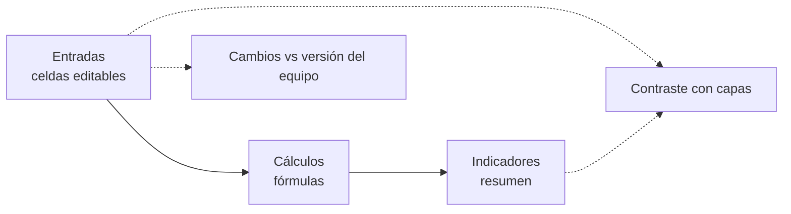

# Modelo de cálculo — Línea de quesos

Este documento resume los datos y cálculos del modelo de indicadores de una línea de producción de queso **Campesino, Mozzarella y Sopó**. El objetivo es estimar si la línea tiene capacidad suficiente para atender la demanda y calcular los indicadores vistos en la asignatura: **OEE, Takt Time, capacidad, utilización, rendimiento, productividad y Manufacturing Lead Time (MLT)**.

> **Todos los valores son ilustrativos (ASSUMED).** No son datos de una planta real ni del equipo. Sirven para que el modelo calcule y se reemplazan cuando existan valores reales. Los valores de proceso están **alineados con las 12 capas de la línea** (capas 5, 8, 9 y 10: 3 tinas, 7 lotes por día, Sopó con maduración de 150 días). MTBF, MTTR, RE, SE, rechazo y cambio de producto son supuestos propios que dan un OEE de **67,1 %**, cercano a la eficiencia global base de 65 % de la capa 9 y propio de una planta colombiana pequeña o mediana.

**Archivo:** [`modelo_indicadores_quesos.xlsx`](modelo_indicadores_quesos.xlsx)

## Estructura del libro



| Hoja | Contenido |
|---|---|
| **Entradas** | Parámetros editables (azul sobre amarillo) con columna *Origen* (`PUBLIC`, `REFERENCE`, `ASSUMED`, `CALCULATED`, `PROPOSED`, `PENDING`) y nota con la capa de donde sale cada valor. |
| **Cálculos** | Lotes, balance de masa, tiempo disponible y OEE, Takt, capacidad, utilización, MLT y WIP. Todo son fórmulas. |
| **Indicadores** | Resumen con el nivel de OEE según la tabla de Cortés. |
| **Contraste con capas** | Compara cada resultado del modelo con el valor registrado en las 12 capas y explica las diferencias. |
| **Cambios vs versión del equipo** | Qué entradas cambiaron respecto al modelo anterior y por qué. |

Colores: azul sobre amarillo = entrada editable · negro = fórmula · verde = vínculo directo a otra hoja.

## Entradas del modelo

### Parámetros generales

| Parámetro | Valor | Unidad | Base |
|---|---|---|---|
| Demanda total de queso | 3.000 | kg/día | Ejemplo de las convenciones del modelo. Las capas dicen que capacidad y demanda son independientes; el plan de las capas produce 3.510 kg/día (7 lotes) |
| Turnos por día | 2 | turnos/día | Capa 9: 2 turnos de 8 h |
| Horas por turno | 8 | h/turno | Capa 9 |
| Días operativos por semana | 6 | días/sem | Capa 9: 6 días de producción por semana |
| Equipos restrictivos en paralelo (tinas) | 3 | unidades | Capas 5 y 9: 3 tinas de 5.000 L con 4.500 kg útiles |
| Tiempo de cambio de producto | 30 | min/cambio | Supuesto; `Q-TMP-023` está pendiente en las capas |
| MTBF | 22 | h | Supuesto del modelo de indicadores |
| MTTR | 4 | h | Supuesto del modelo de indicadores |
| Tasa de eficiencia RE | 88 % | — | Supuesto; junto con MTBF, MTTR y SE da un OEE cercano al 65 % de la capa 9 |
| Eficiencia en velocidad SE | 92 % | — | Supuesto |
| Personas por turno (línea) | 10 | personas | Capa 10: 1 en recepción y tratamiento térmico, 3 en elaboración, 3 en empaque, 1 en calidad, 1 supervisor y 1 en limpieza |
| Densidad de la leche | 1,03 | kg/L | Referencia (análisis de UHT y capa 1) |

### Parámetros por producto

| Parámetro | Unidad | Campesino | Mozzarella | Sopó | Base |
|---|---|---|---|---|---|
| Mezcla de demanda | % | 46,2 % | 28,2 % | 25,6 % | Reparto de masa del plan de las capas (1.620, 990 y 900 kg de 3.510 kg). `CALCULATED` |
| Tamaño de lote (leche) | kg leche/lote | 4.500 | 4.500 | 4.500 | Capa 9 (≈ 4.370 L) |
| Rendimiento (`Q-CAP-011`) | kg queso/kg leche | 0,12 | 0,11 | 0,10 | Capa 9: 540, 495 y 450 kg de queso por lote |
| Rechazo | % | 2 % | 2 % | 2 % | Supuesto del modelo; no está en las capas |
| Ocupación de la tina, sin CIP ni preparación (`Q-TMP-026`) | h/lote | 2,9 | 2,9 | 3,4 | Capa 8: 224 / 224 / 254 min de tina menos 50 min de CIP. `CALCULATED` |
| Preparación (`Q-TMP-021`) | min/lote | 0 | 0 | 0 | Capa 8: va incluida en el llenado de la tina |
| Limpieza CIP (`Q-TMP-022`) | min/lote | 50 | 50 | 50 | Capa 8 |
| Almacenamiento de leche antes del proceso (`Q-TMP-003`) | h | 12 | 12 | 12 | Capa 8: ≈ 12 h a ≤ 4 °C |
| Fabricación activa (`Q-TMP-027*`) | h/lote | 4,2 | 5,2 | 41,1 | Capa 8; el Sopó incluye ≈ 36 h de salmuera y la mozzarella ≈ 1 h de estirado |
| Esperas y oreo (`Q-TMP-024`) | h/lote | 0 | 0,5 | 12 | Capa 8: mozzarella 30 min antes del empaque; Sopó ≈ 12 h de oreo |
| Enfriamiento y acondicionamiento (`Q-TMP-017`) | h/lote | 12 | 1,25 | 2,5 | Capa 8 |
| Maduración (`Q-TMP-016`) | días | 0 | 0 | 150 | Capa 8: Sopó ≈ 5 meses a 9–11 °C |
| Retención hasta la liberación (`Q-TMP-019`) | h | 72 | 72 | 120 | Capa 8: 3 días (frescos) y 5 días (Sopó) |

## Fórmulas principales

```text
Lotes/día (enteros)   = ROUNDUP( demanda_producto / (kg_leche_lote × rendimiento × (1 − rechazo)) )

Tt  = turnos × horas × 60                              (min/día por equipo)
Tip = Σ lotes × (preparación + CIP) / n  +  cambios × t_cambio
Tep = Tt − Tip
A   = MTBF / (MTBF + MTTR)
Ter = Tep × A                                          (tiempo neto disponible)
PE  = RE × SE
Q   = (producción − defectuosos) / producción          (ponderada por lotes)
OEE = A × PE × Q

Takt T = Ter / lotes_por_día
Tc     = (ocupación_diseñada / PE) / n                 (ciclo efectivo de la etapa restrictiva)
Cumple si Tc ≤ T

PC  = n · S · H · Rp                                   (capacidad nominal)
U   = Q / PC                                           (utilización, definición del curso)
Q-CAP-010 = ocupación real / (n · Ter)                 (utilización de la capa 9)

MLT = Tsu + almacenamiento de leche + fabricación activa + esperas
      + enfriamiento + maduración + retención hasta la liberación
Inventario en maduración = producción buena diaria × días de maduración × 6/7   (días de producción)
```

Los lotes se redondean hacia arriba, por lo que la producción planificada supera la demanda (sobreproducción por lotes enteros). Con el lote como unidad (Q = 1), el término (Q−1)·Tc_n del curso vale cero.

## Resultados con las entradas actuales

| Indicador | Valor |
|---|---|
| Lotes requeridos por día | 7 (3 + 2 + 2) |
| Producción buena planificada | 3.440 kg/día (14,7 % sobre la demanda) |
| Leche requerida | 31.500 kg/día (≈ 30.583 L/día) |
| Disponibilidad A | 84,6 % |
| Eficiencia de desempeño PE | 81,0 % |
| Tasa de calidad Q | 98,0 % |
| **OEE** | **67,1 %** — nivel «Regular» (tabla de Cortés: 65 % ≤ OEE < 75 %) |
| Takt / Tc | 94,7 / 75,2 min/lote — Cumple el Takt (margen 20,6 %) |
| Takt por kg | 13,3 s/kg |
| Capacidad de la línea en operación (`Q-CAP-012`) | 321,1 kg/h |
| Capacidad diaria con la mezcla planificada (`Q-CAP-007`) | 4.075 kg/día |
| Capacidad por turno (`Q-CAP-006`) | 2.037 kg/turno |
| Capacidad por hora de calendario (`Q-CAP-005`) | 254,7 kg/h |
| Capacidad nominal PC | 7.752 kg/día |
| Utilización U = Q/PC (curso) | 44,4 % |
| Utilización Q-CAP-010 (capa 9) | 79,4 % |
| Rendimiento físico ponderado (`Q-CAP-011`) | 0,111 kg/kg |
| Suero y otras salidas | 27.990 kg/día |
| Productividad de materia prima | 0,109 kg bueno/kg leche |
| Productividad de mano de obra | 172 kg/persona-turno |
| MLT Campesino / Mozzarella / Sopó | 4,2 / 3,8 / 157,8 días |
| % de valor agregado | 2,9 % / 3,2 % / 0,09 % |
| Inventario en maduración, Sopó (`Q-CAP-009`) | 113.400 kg |
| Producto terminado en retención | 12.083 kg |

## Contraste con las 12 capas

El libro compara cada resultado con lo registrado en las capas (hoja *Contraste con capas*).

| Indicador | Modelo | Capas | Comentario |
|---|---|---|---|
| Lotes por día | 7 | 7 (3 + 2 + 2) | Coinciden. |
| Tinas | 3 | 3 | Capas 5 y 9. |
| Producción buena planificada | 3.440 kg/día | 3.510 kg/día | El modelo descuenta el rechazo de 2 %, que las capas no tienen. |
| Leche requerida | 31.500 kg/día | 31.500 kg/día | Siete lotes de 4.500 kg. |
| Rendimiento ponderado | 0,111 | 0,111 | `Q-CAP-011`. |
| Capacidad por hora de calendario | 254,7 kg/h | ≈ 219 kg/h | Las capas dividen 3.510 kg entre 16 h sin descontar paradas; el modelo sí las descuenta. |
| OEE | 67,1 % | ≈ 65 % | El modelo lo obtiene de A × PE × Q con MTBF, MTTR, RE y SE supuestos; las capas parten del 65 % directo. |
| Utilización de las tinas (`Q-CAP-010`) | 79,4 % | 87 % | Ver nota abajo. |
| Inventario en maduración | 113.400 kg | ≈ 116.000 kg | Las capas usan 900 kg diarios; el modelo usa la producción buena diaria. |
| Producto terminado en retención | 12.083 kg | ≈ 12.300 kg | `Q-CAP-008`: 2.610 kg de frescos × 3 días + 900 kg de Sopó × 5 días. |
| MLT Campesino / Mozzarella / Sopó | 4,2 / 3,8 / 157,8 días | ≈ 4,2 / 3,8 / 158 | Tiempo hasta la liberación; el Sopó incluye 150 días de maduración. |
| Personas por turno | 10 | 10 | Capa 10. |

**Utilización 87 % frente a 79 %.** Ambos cálculos parten de la misma carga: 27,1 h de tina al día (3 × 224 + 2 × 224 + 2 × 254 min). Las capas la dividen entre 3 tinas × 16 h × 65 % = 31,2 h (87 %). El modelo divide la carga entre PE y el tiempo disponible solo descuenta cambios de producto y fallas (≈ 42 h entre las tres tinas), por eso sale 79 %. La diferencia es de definición del tiempo disponible, no un error; al citar la cifra hay que indicar qué definición se usa.

## Cambios respecto al modelo del equipo

Se conservan la estructura, las fórmulas y los indicadores. Cambian las entradas, para que coincidan con las 12 capas (hoja *Cambios vs versión del equipo*).

| Parámetro | Modelo del equipo | Esta versión (capas) | Por qué |
|---|---|---|---|
| Tinas | 3 (archivo adjunto) o 4 (versión «realista») | 3 | Capas 5 y 9: 3 tinas de 5.000 L |
| Lotes por día | 8 (3 + 3 + 2) | 7 (3 + 2 + 2) | Sale de la mezcla de las capas; no se fuerza |
| Mezcla de demanda | 40 / 35 / 25 % | 46 / 28 / 26 % | Reparto de masa del plan diario de las capas |
| Rendimiento | 0,105 / 0,10 / 0,095 | 0,12 / 0,11 / 0,10 | Capa 9, `Q-CAP-011` |
| Ocupación de la tina (sin CIP ni preparación) | 3,5 / 4,0 / 3,5 h | 2,9 / 2,9 / 3,4 h | Capa 8: 224 / 224 / 254 min incluyen 50 min de CIP |
| Preparación del equipo | 20 o 30 min | 0 min | Capa 8: incluida en el llenado de la tina |
| CIP | 45 min | 50 min | Capa 8 |
| Personas por turno | 6 | 10 | Capa 10 |
| Maduración del Sopó | 30 días | 150 días | Capa 8: ≈ 5 meses |
| Fabricación activa | 5 / 5,5 / 5 h | 4,2 / 5,2 / 41,1 h | Capa 8; el Sopó incluye ≈ 36 h de salmuera |
| Retención hasta la liberación | 24 h | 72 / 72 / 120 h | Capa 8: 3 días (frescos) y 5 días (Sopó) |
| Almacenamiento de leche, enfriamiento y oreo | No estaban | 12 h; 12 / 1,25 / 2,5 h; 0 / 0,5 / 12 h | Capa 8; entran al MLT |
| Inventario en maduración | Producción diaria × días de calendario | × 6/7 (días de producción) | Capa 9: ≈ 129 días de producción dentro de los 150 |
| MTBF, MTTR, RE, SE, rechazo, cambio de producto | Supuestos del equipo | 22 h, 4 h, 88 %, 92 %, 2 %, 30 min | No están en las capas; siguen como supuestos del modelo |

## Supuestos y limitaciones

- **Todo es ASSUMED.** Los valores de proceso salen de las capas, que a su vez son supuestos. Las referencias respaldan solo el rango típico de OEE; para MTBF, MTTR, RE, SE, rechazo y cambio de producto no hay fuente directa y deben reemplazarse con registros de la planta.
- **OEE.** Sale 67,1 %, no exactamente 65 %. Queda dentro del rango típico de las referencias para alimentos y bebidas y en el nivel «Regular» de la tabla de Cortés.
- **Rendimientos por encima de la referencia citada.** Los de la capa 9 (0,12 / 0,11 / 0,10 kg/kg) equivalen a ≈ 8,3 / 9,1 / 10 L de leche por kg de queso. CONtexto Ganadero reporta 10–12 L/kg para quesos frescos y 15–20 L/kg para quesos curados, y el Sopó madura 150 días. El modelo es sensible a esto (cálculo propio con las mismas fórmulas, mezcla de demanda y rechazo sin cambios; a la mozzarella se le aplicó el rango de frescos):

  | Escenario | Rendimientos (C / M / S) | Lotes/día | 3 tinas: Takt / Tc (min) | 4 tinas: Takt / Tc (min) |
  |---|---|---|---|---|
  | Modelo (capa 9) | 0,12 / 0,11 / 0,10 | 7 | 94,7 / 75,2 — cumple | — |
  | Referencias, extremo favorable (10 y 15 L/kg) | 0,10 / 0,10 / 0,067 | 9 | 70,5 / 75,8 — **no cumple** | 74,0 / 56,8 — cumple |
  | Referencias, extremo exigente (12 y 20 L/kg) | 0,083 / 0,083 / 0,05 | 11 | 55,1 / 76,1 — **no cumple** | 58,7 / 57,1 — cumple (margen 2,7 %) |

  Conviene confirmar el rendimiento real con el equipo, porque cambia el número de tinas necesarias.
- **Demanda de ejemplo.** 3.000 kg/día es un valor de las convenciones; el plan de las capas produce 3.510 kg/día. Al cambiar la demanda, cambia el número de lotes.
- **Lotes enteros diarios.** La sobreproducción (14,7 %) baja si los lotes se reparten entre días.
- **Capacidad dedicada.** Solo se cuentan lotes completos por turno (conservador).
- **Inactividad.** Preparación, CIP y cambios de producto se tratan como inactividad planeada; según la definición del curso podrían ir como no planeada, lo que bajaría la disponibilidad y el OEE. Las referencias señalan que la limpieza y los cambios son la principal causa de pérdida de disponibilidad en alimentos y bebidas.
- **Dos utilizaciones distintas** (U = Q/PC y `Q-CAP-010`); conviene alinear con el equipo cuál se reporta.
- **Fuera de alcance:** eficiencia económica (ventas/costos), que requiere precios y costos.

## Referencias

- Cortés y García — definiciones de OEE, Takt, capacidad, utilización, rendimiento y MLT (material del curso).
- Reliamag, *OEE Benchmarks by Industry: What World Class Really Means* — alimentos y bebidas: OEE típico 60–78 %, mejores en su clase 80–85 %. El 85 % «world class» sale de 90 % de disponibilidad × 95 % de desempeño × 99 % de calidad (TPM, manufactura discreta). <https://reliamag.com/guides/oee-benchmarks-by-industry-what-world-class-really-means/>
- Enaovision, *OEE benchmark by industry* — alimentos y bebidas: mediana 62 %, rango 49–73 % (58 plantas). <https://enaovision.com/blog/oee-benchmark-by-industry>
- Vorne / Nakajima (TPM) — origen del 85 % «world class»; citado a través de Reliamag.
- CONtexto Ganadero, *¿Cuántos litros de leche se necesitan para producir 1 kg de queso?* (26 de julio de 2023) — 10–12 L/kg para queso fresco y 15–20 L/kg para quesos curados como el cheddar; las cifras las atribuye a otro portal y no son específicas de Campesino, Mozzarella ni Sopó. <https://www.contextoganadero.com/ganaderia-sostenible/cuantos-litros-de-leche-se-necesitan-para-producir-un-1-kg-de-queso>
- Universidad de Chile (repositorio.uchile.cl) — rendimiento práctico de queso Gouda: 10,81 kg/100 kg de leche. *No verificada en esta revisión.*

Los benchmarks de OEE son referencias generales de la industria, no específicas de Colombia.
